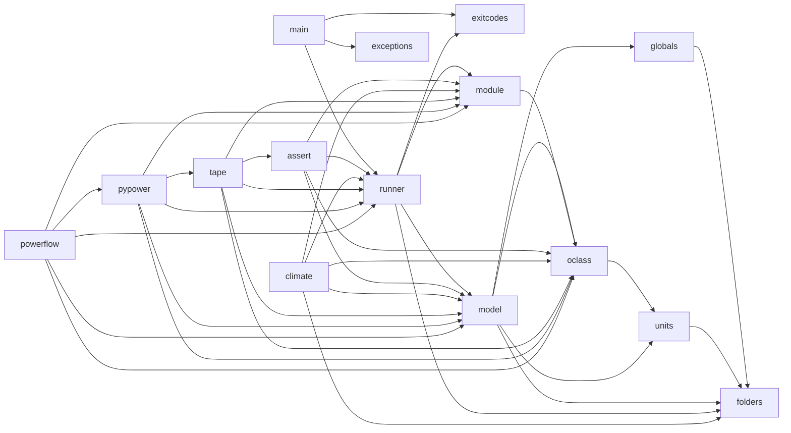

# arras-energy/arras — package design (draft 3)

Status: decisions recorded from the code as merged through #16, 2026-11-23;
modules and solver dispatch (`arras.module`, #22) added 2026-11-23;
internal item and heartbeat dispatch added 2026-11-23;
runner decisions revised for #45, 2026-11-24;
folders without a gridlabd install (`arras.folders`, decision 1.12, #47), 2026-11-24;
gridlabd modules as Python packages and the `assert` module (decisions 1.13, 6.15, group 8, #49), 2026-11-24;
the `climate` module (group 9, #51), 2026-11-24;
the `tape` module, `Runner.setexitcode()`, and `method` properties in GLM (decisions 2.14, 6.16, group 10, #53), 2026-11-24;
the `pypower` module and the vendored PYPOWER solver (group 11, #55), 2026-11-24;
the `powerflow` module, first step: `powerflow_object`, `node`, `link`, `fuse`, `line`, the library classes, and the three-phase PYPOWER solver (group 12, #58), 2026-11-25/26

## Purpose

`arras` is the Python package of the Arras Energy release of HiPAS
GridLAB-D. It provides:

- the `arras` command and `arras.runner.Runner`, which solve the
  quasi-steady time series of a model in Python, and
- an independent Python model of the gridlabd core's data structures:
  global variables (`arras.globals`), object classes (`arras.oclass`),
  units (`arras.units`), models with GLM and JSON input and output
  (`arras.model`), and modules with the solvers that keep the clock
  synchronized (`arras.module`); and
- gridlabd modules implemented in Python, each a top-level package under
  `src/` (`assert`, `climate`, `tape`, `pypower`, and `powerflow`,
  decision groups 8 to 12).

The Python model reads, checks, edits, and writes what gridlabd reads and
writes, without running `gridlabd`. Users get the same values, text, and
errors that gridlabd gives, or a documented difference.

`arras.runner` models the main loop of the gridlabd core (clock advance,
object synchronization passes, iteration, commit) and calls the objects'
event handlers and the module solvers, heartbeats, and internal items of
`arras.module` as the core does; it does not run `gridlabd` (since
2026-11-24, #45, answering #25). `arras.module` models how the core combines
the results of the solvers that modules export, the class heartbeat
functions, and the internal items (random variables, schedules, loadshapes,
transforms, enduses), with all of them written as Python callables
(decisions 7.3, 7.8, 7.9). Excluded: the gridlabd modules (`powerflow`,
`residential`, ...) themselves, deltamode, realtime mode, and multithreaded
passes. These stay in the C++ code of
[arras-energy/gridlabd](https://github.com/arras-energy/gridlabd), except
the modules ported to Python packages (1.13); `powerflow` is being ported
class by class, starting at the base of its class hierarchy (group 12).
The classes that modules publish come into `arras` from JSON that gridlabd
writes.

Reference version: gridlabd `master` at 076e78a (2026-08-16). Every
"Differences from gridlabd" section in the module docstrings is stated
against that commit; the `assert` package's are stated against that commit
with the gridlabd `assert-fixes` branch (8.4).

## Decisions settled

Decisions are numbered `MAJOR.MINOR`. The major number groups decisions by
module (1 is the whole package); the minor number is the decision. Numbers
are permanent: a new decision takes the next minor number in its group, a
new module takes the next major number, and a reversed decision is edited in
place with the date noted rather than deleted. Code comments, issues, and
PRs can cite "decision 4.3".

### 1. Package

| # | Decision |
|---|---|
| 1.1 | `arras` is an independent Python model of the gridlabd core. No module reads from or writes to a running `gridlabd` process or loads module libraries. (Edited 2026-11-24, #45: `arras.runner` no longer runs `gridlabd`.) |
| 1.2 | Where gridlabd's code and its documentation agree, `arras` reproduces the code's behavior: the same output strings, the same accepted inputs, and the same numbers. This includes parsing quirks that change results (see 5.4). |
| 1.3 | Where gridlabd's code and its documentation disagree, `arras` follows the documentation. |
| 1.4 | Every behavior that differs from gridlabd is listed in a numbered "Differences from gridlabd" section of the module docstring, with the gridlabd commit it was checked against, and called out for review in the PR that introduces it. |
| 1.5 | Each part of the gridlabd core is one module with one public class (`Globals`, `Class`, `Units`, `Model`, `Module`). The public classes and their exceptions are re-exported from `arras/__init__.py`. (`Module` added 2026-11-23, #22.) |
| 1.6 | Each module raises its own exception (`GlobalsError`, `ClassError`, `UnitsError`, `ModelError`, `ModuleError`), all derived from `arras.exceptions.ArrasException`. Arguments are checked early, and the exceptions are documented. (`ModuleError` added 2026-11-23, #22.) |
| 1.7 | Docstrings are the user documentation (pdoc, published to https://arras-energy.github.io/arras). Each module docstring has Syntax, Arguments, a spec-style Description ("expected to satisfy: 1. ..."), Examples with real output, Caveats, Differences from gridlabd, and References to the gridlabd source files. |
| 1.8 | Module docstring examples and the README examples run as doctests in the test suite. |
| 1.9 | Tests are fast and self-contained: no network, no credentials, no gridlabd install; the suite finishes in seconds. Coverage is reported but has no threshold. |
| 1.10 | Python 3.12 only (`requires-python = "== 3.12.*"`). CI pins `ubuntu-24.04` and Python 3.12 and installs the package non-editable to catch packaging mistakes. |
| 1.11 | Source layout is `src/arras/`; tests are in `src/arras/_test/` with their data in `src/arras/_test/data/` and a README for each. A gridlabd module package (1.13) follows the same layout in `src/NAME/` (`src/NAME/_test/`, `src/NAME/_test/data/`); its test file names do not repeat those of other packages, because the test folders are not packages. (Edited 2026-11-24, #49.) |
| 1.12 | `arras` does not depend on gridlabd folders or files (`/usr/local/opt/gridlabd`, `GLD_*`, `GLTEMP`, `~/.gridlabd`, `/tmp/gridlabd-*`). `arras.folders` gives three folders: the package folder (`PACKAGEDIR`, where Python imports `arras` from) for files installed with `arras`; the user folder (`ARRAS_USERDIR`, else `~/.arras`, with `share`, `lib`, `include`, `var`, and `tmp` subfolders) for files installed at runtime and shared by all models; and the working folder for project files. Files are searched in the working folder, the user `share` folder, the folders listed in `GLPATH` (optional, separated by `;` or `os.pathsep`), then the package folder. No folder is created unless code asks for it. (2026-11-24, #47) |
| 1.13 | A gridlabd module implemented in Python is a top-level package named for the module, in `src/NAME/`, installed with the `arras` distribution. It registers itself in the `arras.modules` entry point group (`[project.entry-points."arras.modules"]` in `pyproject.toml`) with a function `load(model)`, which `Model.load_module()` calls (6.15). The package registers the module in `Module.registry`, its classes in `Class.registry` with the properties gridlabd publishes, and its globals in the model. Object behavior comes from class event handlers `python:NAME.FUNCTION` (2.6), since the runner gives objects behavior only through handlers. A module name that is a Python keyword (`assert`) is imported with `importlib.import_module()`. Other distributions can provide modules the same way. (2026-11-24, #49) |

### 2. Command line and runner (`main`, `runner`, `exitcodes`, `exceptions`)

| # | Decision |
|---|---|
| 2.1 | The `arras` command (`arras.main:main`) passes its arguments to `arras.runner.Runner`, prints the runner's output and error lines through the progress callback as they arrive, and returns the runner's exit code. `Runner` processes the arguments in order: model files, `-D`, `-o`, `-c`, `-C`, `-I`, `-q`, `-v`, `-w`, `--debug`; any other option fails with `ARGERR`. The package docstring lists only these options. (Edited 2026-11-24, #45: the command no longer runs `gridlabd.bin`.) |
| 2.2 | `Runner` does not set environment variables or run an executable; the `exe` and `subprocess.run` keyword arguments are removed (#45). `Runner.GRIDLABD_PATH` is removed: folder globals come from `arras.folders` (1.12, 3.6). (Edited 2026-11-24.) |
| 2.3 | Exit codes in `arras.exitcodes` use gridlabd's values. An exception caught by `main()` returns `EXCEPTION` (255). |
| 2.4 | An exception caught by `main()` prints one line, `EXCEPTION [arras/FILE@LINE]: MESSAGE`, to stderr. `arras.exceptions.DEBUG` re-raises instead, and `TRACE` adds a traceback. |
| 2.5 | `Runner` reproduces the event-mode main loop of `GldExec::exec_start()` (`source/exec.cpp`): objects initialized in creation order with `init_max_defer` deferral rounds, then `Module.initall()`; at each iteration `Module.internalsyncall()` with the objects whose `heartbeat` header is greater than 0; on the first iteration of a time step object precommit then `Module.precommitall()`, whose result is posted as an event (the clock itself means no event); `Module.presyncall()` and presync top-down, sync bottom-up and `Module.syncall()`, `Module.postsyncall()` and postsync top-down, by rank (parents rank above children, `set_rank()`), equal ranks in creation order, with `Module.transformsyncall()` for non-schedule sources after each pass; hard and soft events merged as `sync_set()` does, with `stoptime+1` as a hard event when `stoptime` is set; `minimum_timestep` rounding of object hard events; iteration while the earliest event is the clock, up to `iteration_limit`; object commit then `Module.commitall()`, every object's `clock` set, then `Module.clockupdateall()`, posted as a hard event only when it lowers the next time; `in_svc`/`out_svc`; finalize then `Module.termall()` after the time series, also after a failure or stop. Object commit times other than `TS_INVALID` and 0 are ignored, as in `commit_all()`. Two core behaviors are fixed rather than reproduced (2.12, 2.13). (Edited 2026-11-24, #45: module solvers, internal items, and heartbeats added after #23 merged.) |
| 2.6 | Object behavior comes only from event handlers (`docs/GLM/Object/Events.md`): an object's `on_<event>` property, else its class's. `python:MODULE.FUNCTION` calls `FUNCTION(name, t)`; other text runs as a shell command with `CLOCK`, `HOSTNAME`, `PORT`, and `OBJECT` set and its output lines captured. Class `PASSCONFIG` bits do not add objects to passes. For each module that the model loads and that has no solvers in `Module.registry`, a Python file `NAME.py` in a `pythonpath` folder, the working folder, or the user `lib` folder (1.12) is imported and its `on_init(t)` ... `on_term(t)` functions become the module's solvers, wrapped as `python/python.cpp` does (exceptions and non-integer sync results give `TS_INVALID` or false with an error line). The module stays registered after the run. |
| 2.7 | Errors during a run do not raise: `Runner` records `returncode` (`ARGERR`, `LDERR`, `INIERR`, `RUNERR`, `IOERR`, or `EXCEPTION` for an unexpected exception) and adds `ERROR [TIME]: text` to `stderr`. Only bad constructor arguments raise `RunnerError`. |
| 2.8 | `stdout` and `stderr` are lists of lines. Handlers add lines with `Runner.current().output()`, `.error()`, `.warning()`, and `.verbose()`; verbose, warning, and debug lines follow the `verbose`, `warn`, `debug`, and `quiet` globals of the model. (`verbose()` added 2026-11-24 for module packages, 1.13.) |
| 2.9 | `background=True` runs the simulation in a daemon thread of the calling process; `running`, `wait()`, and `stop()` control it. A thread rather than a process keeps the model, its classes, and Python handlers shared with the caller without serialization. |
| 2.10 | The progress callback is called after each committed time step and once at the end, with only those of the optional arguments `timestamp`, `percent`, `stdout`, `stderr` that its signature names (all with `**kwargs`); `stdout` and `stderr` hold the lines added since the previous call. Returning `False` stops the run; raising stops it with `RUNERR`. |
| 2.11 | The model given with `-o` is written whenever the model was loaded, also after a failed run. |
| 2.12 | Soft events alone end a run when `stoptime` is `NEVER`, as the comment in `exec_start()` intends. gridlabd's `clock_update_modules()` posts the next time as a hard event after every committed step, so its loop never stops on soft events; `Runner` posts the `clockupdate` result only when a solver lowers the next time. Listed as runner difference 8. (2026-11-24, #45.) |
| 2.13 | A module `precommit` result is checked and used like a `presync` result: `TS_INVALID`, 0, or a time before the clock fails the run, and a later time is an event. gridlabd's `precommit_all()` tests `module_precommitall()` as a truth value, so only 0 fails and times are discarded. A Python module's `on_precommit` may return `True` (no event) or `False` (failure). Listed as runner difference 9. (2026-11-24, #45.) |
| 2.14 | `Runner.setexitcode(code)` sets the exit code that a run ends with when it does not fail otherwise, as gridlabd's `exec_setexitcode()` does; the run goes on. gridlabd's `output_error()` calls it with `RUNERR`, so every error message fails a gridlabd run once it ends; `Runner.error()` does not, so that handlers keep deciding, and module packages call `setexitcode()` where gridlabd writes an error and goes on (`tape`, 10.6). (2026-11-24, #53) |

### 3. Global variables (`arras.globals`)

| # | Decision |
|---|---|
| 3.1 | `Globals()` defines every entry of the `map[]` table in gridlabd's `source/globals.cpp` (160 names, including the aliases that share storage), in the same order, with the same type, access, description, and keywords, and with the defaults of `source/globals.h`. |
| 3.2 | `get(name)` returns the string that `gridlabd --globals` prints for that global, using gridlabd's conversion rules. `set(name,value)` converts strings as `global_setvar()` does and also accepts typed Python values. |
| 3.3 | `strictnames` is true by default, as in gridlabd: setting an undefined name raises `GlobalsError`. When it is false, the name is created as a `char1024` global. |
| 3.4 | `get(spec)` evaluates pseudo-globals and `${...}` expansions in the order that `global_getvar()` tests them, and returns `None` where gridlabd returns `NULL`. |
| 3.5 | Pseudo-globals that need a model (`FIND`, `object.last`, `GEOCODE OBJECT`) call the assignable hooks `object_finder`, `object_last`, and `object_locator`, so `arras.globals` does not depend on `arras.model`. Without a hook, `FIND` returns an empty string and the others return `None`. |
| 3.6 | Values that gridlabd fixes at build or run time (`version*`, `command_line`, `origin`, `gitbranch`, ...) come from the installed `arras` version or start empty. Folder globals come from `arras.folders` (1.12): `datadir`, `libdir`, `incdir`, `vardir`, and `tmp` are subfolders of the user folder, `configpath`, `logfile`, and `pidfile_dir` are in it, `bindir` is the Python scripts folder, and `pythonexec` is the running Python. `GLD_*` and `GLTEMP` are not read; `${FINDFILE}` searches the folders of 1.12, including `GLPATH`. All can be overridden in the constructor. (Edited 2026-11-24.) |
| 3.7 | `set()` does not check `access`, matching `global_setvar()`; the access value is recorded only. |
| 3.8 | Random numbers come from Python's `random` module seeded by `randomseed`. Sequences differ from gridlabd's generator even with the same seed. |
| 3.9 | `timezone_locale` supports `UTC` and IANA zone names (Python `zoneinfo`) only; gridlabd's `tzinfo.txt` is not read. |
| 3.10 | `${PYTHON ...}` and `${SHELL ...}` run code, as in gridlabd. They are not sandboxed; the docstring warns against expanding untrusted text. |
| 3.11 | Expansion forms follow `docs/GLM/Global/` where the core disagrees: `//` replaces every match; `/`, `&`, `|`, `^` are integer operators on int32 globals (`&`, `|~` compare only before `?`); `RANGE` accepts `:`; `:=` and `=string` create the global even under `strictnames`; `RANDOM sampled(...)` and `gamma(alpha[,beta])` work; `RANGE` with a step of zero or less raises. `profile_output_format` keeps the core's empty keyword table. (Module docstring, differences 1–7.) |

### 4. Object classes (`arras.oclass`)

| # | Decision |
|---|---|
| 4.1 | The module is named `oclass` because `class` is a Python keyword; the class is `Class`. |
| 4.2 | `Class.registry` is shared by the whole Python process, as gridlabd's class list is shared by a run. `Class.reset()` clears it. A name may be registered once per module (GLM classes count as module `None`); the same name in another module is allowed. |
| 4.3 | `arras.oclass` does not load module libraries. Module classes are registered by the user or from gridlabd JSON by `arras.model` (6.3). |
| 4.4 | There are two ways to add a property, matching gridlabd's two paths: `add_property()` follows the GLM loader's `class` block rules (an existing property of the same type is returned; a new one is an extended property), and `publish()` follows `class_define_map()` for module classes (`name[unit]` form, reserved header names refused). |
| 4.5 | Units are checked with one `arras.units.Units` manager shared by all classes, `Class.units`, loaded on first use. Users assign another `Units` object to use another unit file; `Class.reset()` keeps it. `Property.unit` stays the unit name and `Property.unit_spec` holds the resolved `Unit`. (#14) |
| 4.6 | Objects are not modeled in `arras.oclass`. `numobjs` is incremented by the object model (`arras.model`), and no property can be added to a class once `numobjs > 0`, as in gridlabd. |
| 4.7 | Class functions are Python callables. Event handlers are stored as script text and are not run. Intrinsic functions, C++ code blocks, `notify` hooks, property delegation, and memory sizes and offsets are not modeled. |
| 4.8 | `modhelp()`, `to_glm()`, and `to_xml()` return the text that `print_class_d()`, `class_saveall()`, and `class_saveall_xml()` write, including the empty `class X {}` block that `class_saveall()` writes without `GSO_NOMACROS`. |
| 4.9 | Stricter than the core, checked when the call is made: `set_parent()` refuses an inheritance loop; `define_keyword()` refuses properties that are not `enumeration` or `set`; `publish()` raises for a `name[unit]` on a type other than `double`/`complex` and for an unknown `unit=`. A deprecated property is logged once. (Module docstring, differences 1–5.) |

### 5. Units (`arras.units`)

| # | Decision |
|---|---|
| 5.1 | `Units` is a port of the gridlabd core unit manager (`source/unit.cpp`) and reads the same `unitfile.txt` format. A copy of gridlabd's `runtime/unitfile.txt` ships in the package (`package-data`). |
| 5.2 | `Units()` loads the first `unitfile.txt` found in the working folder, then the user `share` folder, then each `GLPATH` folder, then the bundled copy in the package folder (1.12). (Edited 2026-11-24.) |
| 5.3 | Each `Units` object has its own unit list. Prefixed and compound units are derived when `find()` asks for them and added to that list, as `unit_find()` does. |
| 5.4 | The parsing behaviors of `unit.cpp` that change results are reproduced so conversions give the same numbers (leading number read twice, `$` ending a derivation, reverse prefix order, second `^` ignored, offset applied to the imaginary part). Each is documented so it can be fixed in both code bases together. |
| 5.5 | `find()` and `convert()` raise `UnitsError` where gridlabd returns `NULL` or `0`. `convert()` returns the value unchanged when both unit names are the same string, as `unit_convert()` does. |
| 5.6 | `test()` runs the conversion table of gridlabd's `unit_test()` (`gridlabd --unitstest`) and returns the number of failures. |

### 6. Models (`arras.model`)

| # | Decision |
|---|---|
| 6.1 | `Model.objects` is a `dict` keyed on object name. An unnamed object is keyed `CLASS:ID`, the name gridlabd's JSON writer uses. |
| 6.2 | An `Object` is a `dict` of property name to value text, with its class in `Object.oclass`. Only properties that were set are stored; `get_property()` returns the class default for the others, or the type default for GLM-declared properties. |
| 6.3 | Classes are registered in the shared `Class.registry` (4.2). Module classes come from gridlabd JSON (`load_classes()`, `read_json()`), from the `Model.module_loader` hook when a GLM file loads a module, or from the user. Runtime classes come from GLM `class` blocks and the JSON `classes` section. |
| 6.4 | Property names and values are checked when they are set: the name must be a header property, an `on_<event>` handler, or a property of the class or a parent; the value is checked against the property type (units converted with `arras.units`, keywords, integer ranges, `charN` sizes, timestamps, references). `strict=False` logs a warning and stores the value as given. |
| 6.5 | `parent` and `object` references are checked when a read finishes, so files may refer to objects that appear later. No object may be its own ancestor. |
| 6.6 | A method that adds, deletes, or sets more than one item checks all of them before changing the model: either every change is made or none is. |
| 6.7 | A GLM or JSON read that fails keeps what was read before the error; reads are not all-or-nothing. |
| 6.8 | `delete_object()` takes `children="error"`, `"orphan"`, or `"delete"`, and `rename()` updates references. Neither has a gridlabd equivalent. |
| 6.9 | JSON follows gridlabd's `GldJsonWriter` format. `write_json()` writes set values, then the class defaults of the other `PUBLIC` properties (left out when `filesave_options` has the `MINIMAL` bit). It leaves out `types`, `object_size`, and `profiler.*`, which need a running gridlabd. |
| 6.10 | `write_glm()` writes only `PUBLIC` globals that differ from their defaults, without `savefile` and `randomstate` (`NOSAVE_GLOBALS`), and writes timestamps in UTC. Its output reads back into the same objects, ids, and values. |
| 6.11 | GLM support is a listed subset of directives and macros (see the module Caveats). Anything else raises `ModelError` with the file and line rather than being skipped. |
| 6.12 | A value that ends at a newline without `;` is refused. |
| 6.13 | Time zone abbreviations (e.g. `PST`) in JSON globals that `Globals` cannot convert (3.9) leave the global at its default and log a warning. Object timestamps in that form are stored as given. |
| 6.14 | Numbers written after unit conversion are rounded to 15 significant digits, so conversion errors such as `1500.0000000000002` do not appear. |
| 6.15 | `Model.load_module(name)` first calls the `arras.modules` entry point named `name`, if an installed distribution provides one (1.13), on every load, so each model gets the module's globals; then it adds the module's registered classes, and calls `Model.module_loader` only when none are registered. An entry point that cannot be loaded, is not callable, or raises an `ArrasException` raises `ModelError`. (2026-11-24, #49) |
| 6.16 | A `method` property given more than once in a GLM object block keeps every value, joined with `,`, as the `property` methods of the `tape` recorders, collectors, and multiplayers add each value to their list. `set_property()` replaces the value. (2026-11-24, #53) |

### 7. Modules (`arras.module`)

| # | Decision |
|---|---|
| 7.1 | `Module.registry` is shared by the whole Python process, in load order, as gridlabd's module list is shared by a run; load order is the order in which solvers are called. `Module(name)` refuses a loaded name; `Module.load(name)` returns the loaded module, as `module_load()` does. `Module.reset()` does not touch `Class.registry`. |
| 7.2 | A module's classes are not stored in the module: `Module.classes` lists the classes in `Class.registry` whose `module` is the module's name, so classes registered by `arras.model` or by the user appear without being added twice. `register_class()` creates a `Class` for the module. |
| 7.3 | Solvers are Python callables attached to the hooks of gridlabd's `struct s_module_list` (`SOLVERS`): `init`, `precommit`, `presync`, `sync`, `postsync`, `commit`, `term`, `clockupdate`, and the deltamode hooks `deltamode_desired`, `preupdate`, `interupdate`, `deltaclockupdate`, `postupdate`. A hook is named by its `arras` name or by the symbol a module library exports (`on_sync`, `clock_update`, `deltaClockUpdate`). `on_term` and `term` share one hook. Solvers do not receive the `MODULE*` argument. |
| 7.4 | The dispatchers (`initall()`, `precommitall()`, `presyncall()`, `syncall()`, `postsyncall()`, `commitall()`, `termall()`, `clockupdateall()`, `deltadesiredall()`, `preupdateall()`, `interupdateall()`, `deltaclockupdateall()`, `postupdateall()`) reproduce how `source/module.cpp`, `GldExec::clock_update_modules()`, and `source/deltamode.cpp` combine module results, including the earliest-by-absolute-time rule for soft (negative) times and `TS_INVALID`, which functions stop at the first failure, and which call every module. |
| 7.5 | The dispatchers do not advance a clock or run object passes. Values that the core reads from globals inside these functions (`deltamode_allowed`, `deltamode_timestep`, `global_clock`, `global_deltaclock`, `global_delta_curr_clock`) are arguments; the defaults are gridlabd's (`allowed=False`, 10 ms). `arras.runner.Runner` calls the event-mode dispatchers from its main loop (2.5); deltamode is not run. (Edited 2026-11-24, #45.) |
| 7.6 | Timestamps are `int` seconds and deltamode steps `int` nanoseconds, with gridlabd's constants (`TS_NEVER`, `TS_INVALID`, `TS_MAX`, `DT_INFINITY`, `DT_INVALID`, `DT_SECOND`, `SM_*`). |
| 7.7 | Stricter than the core: a deltamode module (one with a `deltamode_desired` solver) without a `preupdate`, `interupdate`, or `postupdate` solver makes the dispatcher that needs it raise `ModuleError` (the core calls a null pointer); module names with whitespace, `.`, or `:` and versions outside 0 to 65535 are refused; a solver, heartbeat solver, or internal item that returns a non-`int` (or a `bool`) where a time is expected raises `ModuleError`; a transform needs an explicit source (`"UNKNOWN"` for the core's untyped transform). (Module docstring, differences 1–4.) |
| 7.8 | Heartbeat solvers are attached per class by the class's module (`set_heartbeat()`), as a module sets `CLASS::heartbeat`. `heartbeatsyncall(objects)` takes the heartbeat objects from the caller (objects with `heartbeat > 0`, as `exec_init()` collects them) and does not read objects itself; an object whose class has no solver counts as `TS_NEVER`; parents' solvers are not used. |
| 7.9 | Random variables, schedules, loadshapes, transforms, and enduses are internal items: Python callables `sync(t1)` added with `Module.add_internal()` and kept in `Module.internals` in creation order (transforms with their `TRANSFORMSOURCE` bits, schedules with an `interpolated` flag). Their values, shapes, and transform arithmetic (including schedule skew) are the callables' job. |
| 7.10 | `randomvarsyncall()`, `schedulesyncall()`, `loadshapesyncall()`, `transformsyncall()`, `endusesyncall()`, `heartbeatsyncall()`, and `internalsyncall()` reproduce the single-thread paths of the core functions: absolute-time minimum returned as a soft time for random variables and heartbeats, signed minimum for the others, the schedule and loadshape next-time caches (shared by the process, cleared by `Module.reset()`), the interpolated-schedule override, and `syncall_internals()`'s soft-event combination, `minimum_timestep` rounding, and the zero-terminated `earliest_timestamp()` list. Link and instance times, which `arras` does not model, are arguments. |

### 8. The `assert` module (`src/assert/`, #49)

| # | Decision |
|---|---|
| 8.1 | The package reproduces gridlabd's `module/assert` (`init.cpp`, `assert.cpp`, `double_assert.cpp`, `complex_assert.cpp`, `enum_assert.cpp`, `int_assert.cpp`): the classes `assert`, `double_assert`, `complex_assert`, `enum_assert`, and `int_assert` in registration order, with the published property names, types, keywords (listed in reverse publication order, as gridlabd lists them), defaults (including `within` and `upper` defaulting to `0`, set by `g_assert::create()`), flags, descriptions, `PC_AUTOLOCK|PC_OBSERVER`, and `TRL_PROVEN`; and the `assert::message_flags` global (`INIT_MMF()`). One module per class (`g_assert.py`, `double_assert.py`, ...), each with one public class and the class's documentation; private helpers in `_common.py`, `_compare.py`, `_find.py`, `_base.py`. |
| 8.2 | Each class has `on_init "python:assert.init"` and `on_commit "python:assert.commit"`, which dispatch on the object's class to the `init()` and `commit()` of the class's Python class. The state that the C++ objects keep in members that are not published (targets, the hold start time, `once_value`) is kept per model and object name, and dropped with the model. |
| 8.3 | Messages reproduce the C++ text and routing: `gld_object::error()`, `warning()`, and `verbose()` prefix the object name and follow the object flags (`QUIET`, `WARNING`, `VERBOSE`), taken from the `flags` header and `assert::message_flags`; `gl_error()`, `gl_warning()`, and `gl_verbose()` do not. `init()` failures are written as `INIT_CATCHALL()` writes them. |
| 8.4 | The `assert` class compares as the core does (`property_compare_basic_str()`, `property_compare_basic()`, `source/compare.cpp`, the `convert_to_*()` functions, and the `get_part` functions), with these core and module defects fixed in both code bases (2026-11-24; gridlabd branch `assert-fixes`): integers, enumerations, sets, and timestamps compare their full signed values (the core cast them to a 32-bit `int`, read `int16` as unsigned, and read `enumeration` as 64 bits); a `complex` without a part supports only `==` and `!=`, comparing both parts with `|x-value| <= |within|` (the core compared the real part only, also in `property_is_default()`); a conversion that returns 0 or less is an error (the core compared an uninitialized value when a conversion returned 0, e.g. an object name not found; `convert_to_timestamp_stub()` now reports `TS_INVALID`); `object` parts read the object referred to (`object_get_part()` read the reference's own address); `convert_to_complex()` applies a unit to a value without an imaginary part; `int_assert` stores `value` and `within` in `int32` members, reads targets by their type, refuses a negative `within`, computes in 64 bits, and prints `%lld`; `enum_assert` prints `%d`; the typed asserts name a missing parent `global` (they dereferenced it); `assert` messages no longer repeat the object name. `within` stays the tolerance of `==` and `!=` on real numbers, as documented. |
| 8.5 | Where the C++ code and the documentation disagree, the documentation is corrected to the code (`assert.status` is `{ERROR=3, FALSE=2, TRUE=1, INIT=0, NONE=0}` with default `TRUE`; `int_assert.value` and `within` are `int32`), in the same gridlabd branch, so 1.3 has nothing to follow here. What `arras` cannot reproduce is listed under each module's Differences from gridlabd (1.4): message flags read at initialization, the `group` subset (8.6), and the separate `value`/`lower` and `within`/`upper` properties. |
| 8.6 | `group` supports the header terms of gridlabd's find language (`class`, `isa`, `groupid`, `module`, `id`, `name`, `parent`, `rank` with `=`, `!=`, `<`, `>`, `<=`, `>=`, joined by `;`, `AND`, `and`); other terms make the group not valid. |
| 8.7 | The tests port every gridlabd autotest in `module/assert/autotest/` to `src/assert/_test/data/`, with the changes listed in `src/assert/_test/README.md` (classes of the `powerflow`, `climate`, and `residential` modules declared in GLM, IANA time zones, `randomvar` refreshes replaced by a seeded Python handler). Files named `*_err.glm` must fail with `RUNERR`; the others must succeed. |
| 8.8 | Deltamode update functions (`update_double_assert()`, `update_complex_assert()`, `update_enum_assert()`) and property notifications (`postnotify()`) are not modeled, because `arras` runs no deltamode and has no property notifications; the `once` logic runs the test again when `value` changes. |

## Conventions inherited

From the Eudoxys package guidelines
([eudoxys/claude](https://github.com/eudoxys/claude), `skills/eudoxys-package`):

- pdoc documentation from docstrings, with the docstring section style
  (dashed underlines, `` - `name`: text `` bullets);
- module-level `_logger = logging.getLogger(__file__)`, no `print` in
  library code;
- type-annotated arguments; arguments checked early with documented
  exceptions;
- Validation workflow (pylint informational, pytest with coverage) and
  Documentation workflow (pdoc plus coverage report to GitHub Pages after
  Validation passes on `main`); Validation, Coverage, and Documentation
  badges in the README;
- pinned runner and Python in CI;
- one concern per PR, each PR referencing an approved issue.

Departures: the package uses a `src/` layout, and its documentation is
published at https://arras-energy.github.io/arras rather than under
`eudoxys.com`.

### 9. The `climate` module (`src/climate/`, #51)

| # | Decision |
|---|---|
| 9.1 | The package reproduces gridlabd's `module/climate` (`init.cpp`, `climate.cpp`, `csv_reader.cpp`, `weather.cpp`, `solar_angles.cpp`): the classes `climate`, `weather`, and `csv_reader` in registration order, with the published property names, types, units, keywords, defaults, flags, access, descriptions, pass configurations (`PC_PRETOPDOWN|PC_AUTOLOCK`, `PC_NOSYNC`), and readiness levels, checked against `gridlabd --modhelp climate` and `--modhelp=json`; the seven class functions of `climate`; and the globals `climate::message_flags` and `climate::library_path`. One module per class (`climate.py`, `weather.py`, `csv_reader.py`), with the file reader (`tmy.py`), solar position (`solar_angles.py`), and cloud model (`cloud.py`) in their own modules, and private helpers in `_common.py`. |
| 9.2 | Where the code and gridlabd's documentation disagree, the package follows the code: the documentation pages (`docs/Module/Climate/*.md`) were generated by an older `modhelp` (`city` as `char32`, `solar_dir` and `solar_diff` in `weather`) and do not describe behavior. This reverses 1.3 for this module; see open question 7. |
| 9.3 | Behavior is reproduced value for value, including quirks that change results: the day of the year counted from 0 in the CSV solar flux, the quadratic interpolation's `/2*h*h`, and `fgets()` line parts. Weather files are read with a `sscanf()` work-alike and gridlabd's own formats. The exceptions are in 9.4 and 9.9. |
| 9.4 | Where gridlabd's behavior is undefined, the package defines it and lists it under Differences from gridlabd (1.4): reads past the end of the TMY records (the hours after the last of the year wrap to the first), `record.low_day` and `record.high_day` (`double` members published as `int32`), uninitialized TMY values and records, the shared TMY2 flag and cloud pattern (per object here), `solar` objects without a location, locations outside the cloud pattern, the endless cut search, and an empty CSV file. |
| 9.5 | The cloud model uses a Python `random.Random` per climate object seeded with `randomseed` and the object id, so cloud patterns differ from gridlabd's; `climate.cloud.TILE_SIZE` is a module constant (512, as gridlabd's) so that tests can use smaller tiles. |
| 9.6 | The class functions take the model and the name of a climate object, return the irradiance or `None` where gridlabd returns 0, and use the clock of the running simulation (gridlabd sets an object's clock when it synchronizes; `arras` at the commit). |
| 9.7 | The records of a TMY file depend only on the file, so the last two files read are kept (keyed on path, modification time, and size) and their messages written again when another object or run reads them. |
| 9.8 | The tests port every gridlabd autotest in `module/climate/autotest/` to `src/climate/_test/data/`, with the changes listed in `src/climate/_test/data/README.md`, and compare `arras` with values written by a gridlabd build (master 076e78a) for TMY2, TMY3, and CSV files, the three interpolation modes, daylight saving time, the new year, leap days, and the class functions, within the 6 significant digits of gridlabd's recorders. The Yakima TMY3 file (1.7 MB) is checked in because the autotests need a full year and the tests use no network. |
| 9.9 | Four gridlabd defects are fixed in `arras` only, not in gridlabd (2026-11-24), and listed under Differences from gridlabd (1.4): `wind_dir` is published in degrees, the unit of the values it holds (gridlabd publishes radians); CSV values are converted from the `weather` units to the `climate` units (gridlabd copies the numbers, so its `humidity` from a file in % is 100 times too large and its `wind_speed` is mph labeled m/s); a CSV run that starts after the last sample of the year moves to the first sample of the next year (gridlabd's next event is in the past, a run error); and the cloud model without a weather file asks for an event every minute (gridlabd's presync returns 0, a run error). The tests compare with gridlabd's values converted accordingly and check the two runs that gridlabd fails. |

### 10. The `tape` module (`src/tape/`, #53)

| # | Decision |
|---|---|
| 10.1 | The package reproduces gridlabd's `module/tape` and, inside it, the file operations of the separate `module/tape_file` (the `file` tape mode): the classes `player`, `shaper`, `recorder`, `multi_recorder`, `collector`, `histogram`, `group_recorder`, `violation_recorder`, `metrics_collector`, `metrics_collector_writer`, and `multiplayer` in registration order, with the published property names, types, units, keywords (in reverse publication order, 8.1), defaults (including the values the `create()` functions set, as 8.1 does), flags, descriptions, pass configurations, and readiness levels of `tape.cpp` and the class files; and the globals `tape::gnuplot_path`, `flush_interval`, `csv_data_only`, `csv_header_type` (one value shared with `csv_data_only`, as in gridlabd), `csv_keep_clean`, and `delta_mode_needed`. One module per class, with private helpers: `_common.py` (messages, state, C formats including `%a`, local time, property values as `gl_get_value()`/`gl_set_value()` handle them), `_file.py` (`tape_file.cpp`), `_aggregate.py` (the core's `aggregate.cpp`), `_json.py` (jsoncpp's `StyledWriter`), and `_base.py` (registration). |
| 10.2 | Where gridlabd's documentation is incomplete or describes older code, the package follows the code (as 9.2 does). Where the documentation describes what the code computes but then defeats, the package follows the documentation (1.3) and lists the difference (1.4): player values in a header unit are converted (`docs/Module/Tape/Player.md`), recorded `double` values in another unit are converted (gridlabd's `convert_from_double()` converts but writes the unconverted number), and file headers follow `header_units` (gridlabd computes `out_property` but never writes it). |
| 10.3 | Behavior is reproduced row for row where gridlabd's is intended: timestamps and values are formatted with gridlabd's formats, headers and footers are gridlabd's, and the year-long `test_player_header` autotest gives gridlabd's output line for line. Behavior that only follows from how gridlabd's code is written is fixed in `arras` (10.4). (Edited 2026-11-24, #53: the quirks kept at first are now fixed.) |
| 10.4 | These gridlabd defects and quirks are fixed in `arras` only, not in gridlabd (2026-11-24), and listed under Differences from gridlabd (1.4) in each class's module: group recorder rows hold every value (gridlabd's `snprintf(... sizeof(line_buffer) ...)` uses the size of a pointer and ends the row after a truncated first value), `interval -1` writes changed rows (gridlabd's commit writes none), and a positive `flush_interval` flushes; the violation recorder checks and counts every object (its lists drop the second object, its unique lists the second name); metrics energies use the interval length (gridlabd multiplies by the flag `interval_write`); a direct shaper asks to run again at the next hour (gridlabd returns 0, a run error), and shape months are 1 to 12 and days 1 to 31 (gridlabd indexes its arrays with the file's numbers from 0); unit conversions of multi-recorders, multiplayers, and recorder output formats include the unit offset (gridlabd multiplies by the conversion of 1, so 0 degF is 0 degC); recorders, multi-recorders, and collectors write exactly `limit` rows (gridlabd `limit`+1), write the last sample of a positive interval when the run ends (gridlabd loses it), and a recorder with `interval 0` writes at the first time; a collector samples from the first time, so its first row is its first sample and its trigger works (gridlabd reads the interval only when the file opens); files still open when the run ends get their end lines (gridlabd leaves collector, multi-recorder, histogram, and group recorder files to the process exit); a multi-recorder's multi-run file is replaced at the end of the run and `line_units ALL` writes units; histogram rows have no trailing comma and `A..B` is a bin (C's `strtod()` reads `A.`); and a looping player skips its CSV header. |
| 10.5 | Where gridlabd's behavior is undefined, the package defines it and lists it (1.4): shaper day 31 has no shape, a triplex line without a conductor uses its configuration's rating, multiplayer values that cannot be read are not written, and aggregates that divide by zero are `nan` or an infinity. |
| 10.6 | Object error messages are written as `gl_error()` writes them and end the run with `RUNERR` without stopping it (`Runner.setexitcode()`, 2.14), as gridlabd's `output_error()` does; the `_err` autotests rely on it. Handlers return `TS_INVALID`, 0, or `False` only where the C++ code returns them. |
| 10.7 | Not modeled: the `memory` and `plot` tape modes (other modes fail as gridlabd fails when it cannot find `tape_MODE`), deltamode (objects with the `DELTAMODE` flag behave as objects without it; the module's deltamode functions are not modeled), the module's `check()` function, and plots. Times that gridlabd takes from the process's time zone (shaper hours, `strftime_format`) use the model's time zone; the `FULL` header's date, user, and host come from the process, as in gridlabd. |
| 10.8 | Classes that the violation recorder and metrics collectors read (powerflow, residential) are found by class name and read by property name, so they may come from gridlabd JSON or GLM stand-ins; group expressions use the find-language subset of `assert._find` (8.6, open question 6). |
| 10.9 | The tests port every gridlabd autotest in `module/tape/autotest/` except the two deltamode tests, to `src/tape/_test/data/`, with the changes listed in `src/tape/_test/data/README.md` (GLM stand-ins for powerflow and residential classes, IANA time zones, `randomvar` refreshes replaced by a seeded Python handler, one-week runs for the random tests). gridlabd's own outputs in the autotest folder (`test_player_header_output.csv`, `test_multiplayer_record_*.csv`) are compared line for line. Without a gridlabd build in the session, the published properties were checked against the C++ source, not against `gridlabd --modhelp tape`. |

### 11. The `pypower` module (`src/pypower/`, #55)

| # | Decision |
|---|---|
| 11.1 | The package reproduces gridlabd's `module/pypower` (`pypower.cpp`, `pypower_solver.py`, and the class files): the classes `bus`, `branch`, `dcline`, `gen`, `gencost`, `geodata`, `load`, `powerplant`, `powerline`, `relay`, `scada`, `shunt`, `transformer`, and `weather` in registration order, with the published property names, types, units, keywords (in reverse publication order, 8.1), defaults (including the values the `create()` functions set), flags, descriptions, pass configurations, and readiness levels; the event handlers each class exports; and the module globals in gridlabd's creation order (`pypower::message_flags`, the globals the class constructors create, then those of `init()`). One module per class, the solver call in `solver.py` (`pypower_solver.py`), and private helpers: `_common.py` (messages, state, values, complex notation), `_base.py` (registration), `_module.py` (the module solvers and the data exchange of `pypower.cpp`), `_controller.py` (object controllers), `_weather.py` (weather files). |
| 11.2 | PYPOWER is vendored as `pypower._pypower`: the 75 modules of PYPOWER 5.1.16 (the version gridlabd pins in `python/requirements.csv`, BSD license) that `runpf()` and `runopf()` import, changed only for numpy 2 and current scipy and for the package path (`src/pypower/_pypower/README.md`). The package name `pypower` (1.13) is PYPOWER's import name, so PYPOWER cannot be a dependency. numpy and scipy become the first third-party dependencies (`requirements.txt`, #19). Their results were checked against PyPI's PYPOWER 5.1.16 under numpy 1.26 and scipy 1.13 on seven cases (2026-11-24). |
| 11.3 | The module solvers `init`, `precommit`, `sync`, `commit`, and `term` reproduce gridlabd's `on_init()` ... `on_term()`. Module initialization (importing the controllers module, allocating the solver data, reading the solver options once) runs when the first pypower object initializes, because `arras.runner` initializes modules after objects and gridlabd's `init_all()` initializes them first; the `init` solver runs it when no object did. #57 proposes `preinit` and `postinit` module events so that modules choose the order explicitly; `pypower` then moves this to `preinit`. |
| 11.4 | The data exchange reproduces `update_controller()` and `update_solution()` item by item: a value is sent only when it differs from the item by more than `solver_update_resolution`; an integer item that is not an integer reads as -1, as `PyLong_AsLong()` gives it, so the first call sends everything, and generator rows that the solver replaced with its (float) solution count as changed at the next sync, which runs the solver again; only the changes of the columns gridlabd counts make the solver run; the solver runs the first time and after such changes; values received that changed make the time step iterate. |
| 11.5 | Behavior that changes results is reproduced, except for the quirks fixed in 11.6. Module precommit times count only as `arras.runner` uses them (2.13). Complex values keep a notation per value as gridlabd's `complex` class does (`j` for new values, the left operand's for arithmetic, `d` from `SetPolar()`), so recordings match gridlabd's. |
| 11.6 | These gridlabd defects are fixed in `arras` (2026-11-24), filed in gridlabd (2026-11-25), and listed under Differences from gridlabd (1.4): `bus.S` is the base load (gridlabd publishes it at the address of `Pd`); bus and load voltage angles are taken in degrees (gridlabd passes degrees to `SetPolar()` as radians); `powerplant.emissions_rate` and `total_emissions` are their own values (gridlabd publishes them at the addresses of `energy_rate` and `total_cost`), costs accumulate over the hours since the last commit (gridlabd's integer division by the time since the last precommit gives 0), and emissions accumulate; `pypower::total_loss` is the loss of the last solution (gridlabd adds every solution's); branch OPF multipliers are received from the solution; the global `pypower::default_reactive_power_fraction` is named without `[pu]` (arras-energy/gridlabd#414). These gridlabd quirks are also fixed in `arras` (2026-11-25), each filed in gridlabd and listed under its module's Differences from gridlabd: a `CONTINUOUS_V` shunt's reference voltage is the limit crossed and its changes start the dwell time (gridlabd#409; gridlabd assigns a `bool`, so the reference is 1, and never sets `last_update`); a `REACTIVE` shunt adds its admittance to `Qd` (gridlabd#408; gridlabd adds it to `Pd`); a generator resets `Pmax` at each presync and its powerplants add the change of their output since their last presync, so generator totals no longer grow with the iterations of a time step (gridlabd#410); a powerline leaves its branch's `rateA` unchanged (gridlabd#411; gridlabd sets it to 0); DC line multipliers are received in the columns they are sent in (gridlabd#412); the ported autotest `controllers.py` treats relay `status` 0 as `CLOSED` (gridlabd#413). |
| 11.7 | Where gridlabd's behavior is undefined, the package defines it and lists it (1.4): a load without parent or `Vn` fails its initialization; divisions by zero give C's infinities and `nan`. |
| 11.8 | The controllers module is imported as a new module object for each run (gridlabd imports it once per process); the `gridlabd` object that gridlabd adds to it is not added. Python exceptions in controllers are one error line. When the `modelname` global is empty (`arras` does not set it), saved case files are named after the run's first model file. |
| 11.9 | Error messages are written as `gl_error()` writes them and end the run with `RUNERR` without stopping it (`Runner.setexitcode()`, 2.14), as `tape` does (10.6). |
| 11.10 | The tests port every gridlabd autotest in `module/pypower/autotest/` (25) to `src/pypower/_test/data/`, with the changes listed in its README: cases converted to GLM by `make_cases.py` (gridlabd's `py2glm.py` conversion), IANA time zones, global units converted, `#for` loops expanded, the `#on_exit` checks made by the tests, and the weather and player files trimmed to the times run. The recordings that gridlabd wrote are compared line for line (except the first row `arras`'s recorders add, 10.4). Without a gridlabd build in the session, published properties were checked against the C++ source. |

### 12. The `powerflow` module (`src/powerflow/`, #58)

| # | Decision |
|---|---|
| 12.1 | The package reproduces gridlabd's `module/powerflow` class by class, from the base of its class hierarchy up. The first step (2026-11-25/26) has the classes `powerflow_object` (abstract), `powerflow_library` (empty, registered for gridlabd's order), `node`, `link`, `fuse`, `line`, and the library classes (12.14), in registration order, `node` and `link` inheriting from `powerflow_object`, and `fuse` and `line` from `link` (`Class.set_parent()`, gridlabd `PT_INHERIT`; `line_configuration` inherits nothing, as in gridlabd), with the published property names, types, units, keywords (in reverse publication order, 8.1), defaults (including the values the `create()` functions set), flags, access, descriptions, pass configurations, and readiness levels, and their initialization checks with gridlabd's messages; and the module globals in gridlabd's creation order (`powerflow::message_flags`, those of `init()`, then those of the class constructors). One module per class, the three-phase solver in `solver.py`, the module solvers in `_module.py`, and private helpers in `_common.py` and `_base.py`. |
| 12.2 | The classes still to be ported are behavior classes that derive from `powerflow.node.Node` or `powerflow.link.Link` and are added to `powerflow._common.BEHAVIORS`; an object's behavior is that of the nearest class in its class's inheritance chain that has one, so GLM classes that inherit from a powerflow class work. A link class gives its admittance through `Link.series_impedance()` and `shunt_admittance()` (series elements) or `Link.admittance()` (the blocks `Yff`, `Yft`, `Ytf`, `Ytt`, for transformers and regulators), with `admittance_key()` naming the values it depends on (the module caches each link's blocks by key). |
| 12.3 | gridlabd's Newton-Raphson solver (`solver_nr.cpp`) is replaced by the vendored PYPOWER 5.1.16 (`pypower._pypower`, 11.2). PYPOWER solves single-phase networks from a bus admittance matrix, so the module gives it a three-phase network in phase coordinates: one solver bus per node phase (base voltage: the node's nominal voltage; base power 1 MVA), each closed link's full 3x3 admittance blocks (with the mutual coupling between phases), and constant-impedance loads in the matrix. Constant-power and constant-current loads (wye on phase voltages, delta on phase-to-phase voltages; constant-current loads turn with the voltage angle and scale with its magnitude, as gridlabd's `NR_current_update()` computes them) are recomputed at the voltages of each solution and PYPOWER is called again until they change by less than 1e-8 per unit. Unbalanced flows are therefore solved without a sequence reduction; the tests check them against an independent solution. |
| 12.4 | `powerflow::solver_method` keeps gridlabd's keywords `FBS`, `GS`, `NR` and adds `FD_XB`, `FD_BX` (PYPOWER `fdpf()`), and `DC` (`dcpf()`). The default is `NR` (gridlabd: `FBS`). `FBS` is deprecated: the module warns once per run and solves with NR, so links do not set FBS ranks or parents. `GS` stays an error, as in gridlabd. The fast-decoupled methods build B' and B'' phase by phase from the same-phase terms of the admittance matrix (PYPOWER's decoupling assumes angles near zero, while phases are 120 degrees apart), with the XB and BX conventions of `makeB()`; only the iteration is simplified, the solution is the full three-phase one. `DC` solves each phase with the self reactances of the links (the diagonal of each series impedance), voltage magnitudes at their initial values, the loads evaluated at the initial voltages, and no losses or reactive flows; a link's flow direction follows the sign of its real power (gridlabd's rule compares the magnitudes in and out, which are equal without losses). |
| 12.5 | The network is solved in the module's `sync` solver, after the objects' syncs (gridlabd solves it in the swing node's sync, which has the highest rank, so the order is the same). The time step iterates when a node voltage changed by more than the node's `maximum_voltage_error`. A solution that reaches `NR_iteration_limit` keeps the voltages reached and iterates the time step, as gridlabd's `node::sync()` does when `solver_nr()` returns a negative count; a solution that cannot be used (singular, not finite) follows `convergence_error_handling` as gridlabd's bad-computation branch does (`COLLAPSE` is an error, "not yet supported", then `FATAL`). |
| 12.6 | Node load properties are loads, positive when they draw power, as gridlabd's code uses them, although their descriptions say "in = positive"; the descriptions are published unchanged (1.3 does not apply: the description text is not documentation of the sign). A node with phase `D` takes `power_A` ... `power_C` (and the current and shunt forms) as phase-to-phase loads `AB`, `BC`, `CA`; the `_AN` and `_AB` forms are wye and delta whatever the connection. `prerotated_current_X` (deltamode) is not used. |
| 12.7 | These gridlabd defects are fixed in `arras` (2026-11-25) and listed under Differences from gridlabd (1.4): `node.shunt_AB` ... `shunt_CN` are their own values (gridlabd publishes them at the addresses of `power_AB` ... `power_CN`); a `link` of the base class is a `powerflow::default_resistance` resistance on each phase (gridlabd inverts the base class's zero `b_mat`). Not yet filed in gridlabd. |
| 12.11 | A `line` object (of the base class) is the pi model of the matrix form of its `line_configuration`, as gridlabd's `line::load_matrix_based_configuration()` and NR use it: `Zabc = zIJ * length/5280` and `Yabc = j 2 pi f cIJ 1e-9 * length/5280` on the terms whose phases the line has (`Yabc` 0, with a warning, unless `powerflow::line_capacitance`), series admittance `inv(Zabc)`, and `Yabc/2` at each end. Line subclasses override `Line.line_matrices()` (12.15). A zero-length line fails whatever the solver method, since every method inverts `Zabc` (gridlabd: only NR); the error keeps gridlabd's message for NR and FBS and names the method (`FD_XB`, `FD_BX`, `DC`) for the others; listed under Differences from gridlabd (1.4). |
| 12.12 | A `fuse` is a switching device (`Link.SWITCH`): each `GOOD` phase is the admittance `(1+j)/fuse_resistance` that gridlabd's NR solver uses (`From_Y`, reproduced although it is not the inverse of gridlabd's `b_mat`, `(1+j)·fuse_resistance`), with every solver method; `BLOWN` phases, or all phases when `status` is `OPEN`, connect nothing, and the phases a switching device disconnects at a to node that has no other link are taken out of the network with voltage 0, as gridlabd's NR does in strictly radial mode. Links get solution hooks for this: `before_solve()` (replaced fuses come back), `after_solve()` (a phase whose `current_in` magnitude exceeds `current_limit` blows, and the time step is solved again), and `next_event()` (the earliest replacement time, returned by the module as a soft event). Exponential replacement durations use Python's `random`, seeded with `randomseed` and the object id. Fuses work with every solver method (2026-11-26): the fast-decoupled methods solve the NR admittance (their iteration matrices keep its true sign, `-Im y`, since through `(1+j)/R` real power flows against the angle difference), and the DC method uses the magnitude of the fuse impedance, `fuse_resistance/sqrt(2)` (`Link.MAGNITUDE`, `Network.magnitude`), because its reactance, `-fuse_resistance/2`, would reverse the flow. Fixed and listed (1.4): a zero `fuse_resistance` becomes `default_resistance`, as gridlabd's warning says (gridlabd keeps 0), and it is checked with every method (gridlabd: NR only); the replacement time is a soft event with every method (gridlabd: FBS only); fuses are not refused with methods other than FBS and NR, as gridlabd refuses them. Reliability, faults, `fault_check`, and `eventgen` are not ported. |
| 12.13 | Islands (12.8) follow the same-phase conduction paths of the branches (`Yft[p, p]`), not the whole admittance matrix: the mutual coupling of a line ties its phases together in the matrix, so a phase cut off from every source (by a blown fuse upstream, say) would otherwise be solved as if supplied by induction. Classes that conduct between phases (transformers) are to add their paths when they are ported. |
| 12.14 | The library classes (those that derive from `powerflow_library` in C++: `line_spacing`, `overhead_line_conductor`, `underground_line_conductor`, `line_configuration`, `transformer_configuration`, `regulator_configuration`, `triplex_line_configuration`, `triplex_line_conductor`, `restoration`, `power_metrics`, `pole_configuration`) are registered in gridlabd's order without a parent class (gridlabd's library classes do not `PT_INHERIT`; `triplex_line_configuration` still answers `isa("line_configuration")` in C++, which `powerflow._common.isa()` reproduces through behavior-class inheritance, so a `line` accepts it), with their properties, the defaults their `create()` functions set, and their initialization checks; `pole_configuration` creates the global `powerflow::climate_impact_zone` (keywords in gridlabd's table order). `transformer_configuration` publishes `resistance`/`reactance` at the parts of `impedance` (and likewise for `impedance1`, `impedance2`, `shunt_impedance`): initialization reconciles them in the order the object set them, so the last one set wins, as with gridlabd's shared storage, and writes all three back. `power_metrics` publishes the functions the reliability module calls (`calc_metrics`, `reset_interval_metrics`, `reset_annual_metrics`, `init_reliability`, `logfile_extra`) as class methods computing the IEEE 1366 indices as gridlabd does; nothing calls them until the reliability module is ported. `restoration` has its initialization (NR only, as in gridlabd) and its `perform_restoration` entry point, which fails without `fault_check` as gridlabd's does; its reconfiguration algorithm is deferred (2026-11-26) to the change that ports `fault_check` and the switch, sectionalizer, and recloser classes it operates, where it can be tested end to end. Fixed and listed (1.4): zero conductor resistances fail with every solver method (gridlabd: NR only), the message naming `NR` for NR and FBS and the keyword for the others; the `transformer_configuration` shunt warning compares with the default 1e9+1e9j (gridlabd: 999999999, so it always warns); an invalid pole treatment method resets `treatment_method` (gridlabd resets `climate_impact_zone`); `regulator_configuration` connections other than `WYE_WYE` fail with every method (gridlabd allows them with FBS); `restoration` reports a name in its lists that is not an object, reports unnamed links as `Unnamed`, and names the link in the missing-`power_out` message (gridlabd's format, `link:s`, lacks the `%`). |
| 12.15 | `overhead_line`, `underground_line`, and `triplex_line` (2026-11-26) inherit from `line` and override `Line.line_matrices()` with gridlabd's `recalc()` of each class: an overhead or underground line whose configuration gives `z11`, `z22`, or `z33` uses the matrix form (12.11); otherwise Carson's equations (gridlabd's unrounded coefficients, `nominal_frequency` or `current_frequency`) on the conductors and spacing, the neutral (overhead) or the concentric neutrals, tape shields, and separate neutral (underground) Kron-reduced, and the potential-coefficient (overhead) or cable (underground) capacitance with `powerflow::line_capacitance`, reproducing gridlabd's quirks (the separate neutral of a tape-shielded cable takes its self term from the phase cable's neutral data; a missing phase gets 1 on the neutral diagonal). The matrices are computed with their warnings at initialization and again, silently, whenever the admittance key changes (which includes the configuration's conductors and spacing and the frequency). The tests check Kersting's examples 4.1, 4.3, 4.4, 5.1, and 5.2 and an independent Kron reduction. `triplex_line` computes gridlabd's `b_mat` and `tn` (NR and FBS only, as gridlabd) but its `admittance()` raises `SolverError`, since split-phase nodes and center-tapped transformers are not ported; it is to be solved when they are. Ice loading, duct banks, conductor ratings, and faults are not ported. Listed (1.4): an underground conductor message names the line (gridlabd's format drops the name it passes); a triplex line without a valid configuration fails with `line`'s message (gridlabd dereferences it unchecked). |
| 12.16 | `transformer` and `regulator` (2026-11-26) inherit from `link`, as in gridlabd (`PT_INHERIT "link"`; deriving them from `line` was considered and declined, since they would inherit `length` and its zero-length rejection and a `configuration` of the wrong class). Their admittance is gridlabd's NR admittance (`YSfrom`, `From_Y`, `To_Y`, `YSto` of `link::init()` and `regulator::presync()`): a transformer's turns ratio `nt` and secondary-side impedance `zt` from its configuration, phase by phase for wye-wye, single-phase, and delta-delta, with gridlabd's `B` and `C` matrices for delta-wye (30 degrees lag step-down, lead step-up), without the shunt impedance (gridlabd's NR leaves it out); a regulator's autotransformer ratio `a` from its taps (type A or B) and its `regulator_resistance`. Center-tapped transformers initialize and are refused by the solver until split-phase nodes are ported. Links get `check_phases()` (gridlabd's delta-wye and split-phase checks) and `dc_model()` (self impedances and shift); the network takes a branch's self impedances (`zt*nt` for transformers, since the delta-wye `Yft` is singular) for the DC and fast-decoupled matrices and its shift as a fixed angle difference in the DC equations. The fast-decoupled methods solve purely resistive branches (plain links, regulators) as reactances of the same magnitude, since their real power depends on voltage magnitudes and the methods did not converge with them (they were singular before); the voltage drop across those branches is small, so the simplification rotates a small drop. Regulator control runs after each solution (`Link.after_solve()`), as one pass of gridlabd's `presync` control with its reverse-flow detection, first-run tap jump, dwell and mechanical delays, and banked or individual control, on the output, remote-node, or line-drop-compensated voltage; a tap change solves again at the same time, and the next dwell or tap time is a soft event. gridlabd alternates its control with NR passes and reads the voltages before the time step is solved, so a tap change can come one solution earlier here (caveat). Fixed and listed (1.4): transformers and regulators work with every solver method; a bad `degradation_factor` and a triplex phase on a transformer that is not center-tapped fail the initialization (gridlabd writes the error and goes on); a configuration's unset `tap_pos_X` is not overwritten with 0 (gridlabd's write-back makes a second regulator sharing the configuration take 0 as set); a zero `regulator_resistance` becomes `default_resistance`, as gridlabd's warning says. Thermal and aging models, in-rush, saturation, violations, and deltamode are not ported. Tests check the transformer voltages against independent fixed-point solutions (wye-wye, delta-wye step-down and step-up, single-phase with degradation, DC angles), the delta-wye blocks, and the regulator ratios, first-run jump, dwell and delay timing, bank, line drop compensation, reverse-flow lock, and shared configuration. |
| 12.17 | `switch` (2026-11-26) inherits from `link`, and `recloser` and `sectionalizer` from `switch`, as in gridlabd. A switch is a switching device (`Link.SWITCH`, the isolated-phase rule of 12.12) whose closed phases are `1/switch_impedance`, with the impedance resolved as gridlabd's NR does (default `default_resistance*(1-j)`, a negative reactance, so the DC method uses its magnitude, `Link.MAGNITUDE`, as for fuses) and `switch_resistance`/`switch_reactance` reconciled with `switch_impedance` in the order they were set. Before each solution the switch applies gridlabd's `switch_sync_function()` (banked majority rule or individual phases); `change_switch_state()`, `change_recloser_state()`, and `change_sectionalizer_state()` are class methods for `fault_check` and `restoration` to call when they are ported (opening a sectionalizer fails without `fault_check`, as in gridlabd). A recloser resets `number_of_tries` at each time step and has gridlabd's defaults for its tries and retry time. Fixed and listed (1.4): a banked switch's previous status is updated after each change (gridlabd never updates it outside meshed fault checking, so its banked phases ignore phase-state changes once `status` differs from its initial value). Reliability, faults, `eventgen`, and deltamode are not ported. |
| 12.18 | `capacitor` and `load` (2026-11-26) inherit from `node`, as in gridlabd (the request named "capacity"; gridlabd has no such class, so it was taken to mean `capacitor`). Nodes get `load_terms()` (loads added to the accumulators when the network is built) and the solution hooks links have (`before_solve()`, `after_solve()`, `next_event()`), which the module now calls for nodes too. A load adds its constant power, current, and impedance (as admittance) loads, phase (delta with phase `D`), explicit wye, and explicit delta, after its ZIP form and frequency dependence, as gridlabd's `load_update_fxn()` does for NR; each complex load and its `_real` and `_reac` parts are kept as one value. A capacitor adds `j Q / cap_nominal_voltage^2` for each closed switch (phase to phase when delta-connected) and runs gridlabd's `cap_sync_fxn()` before each solution (manual changes after `time_delay`; VOLT, VAR, VARVOLT, and CURRENT requests after `dwell_time`; bank control; VARVOLT lockout) and its `postsync` after (switch counts per time step, the forced second solution, the monitored link's reactive power or current, one extra solution per time step when they change a request); a change whose delay has run out takes effect at the next solution at the same time, which gridlabd gets from its NR passes. The Python module `powerflow.load` coexists with the package's `load()` entry point (the function is bound after the submodule import). Fixed and listed (1.4): a delta-connected capacitor on a wye node is a phase-to-phase admittance (gridlabd converts it to wye admittances from the previous iteration's voltages, the same at convergence); a wye-connected capacitor on a delta node fails at initialization (gridlabd at its first solution); the ZIP current of a delta-connected load (and so of a delta `zipload`) is referred to the nominal line-to-line angle, 30 deg ahead of the line-to-neutral angle gridlabd's `load_update_fxn()` uses. Reliability, GFA, in-rush, deltamode, and the low-voltage conversion to impedance are not ported. |
| 12.19 | `meter` (2026-11-26) inherits from `node`; `triplex_node` is published from `powerflow_object` (as gridlabd, to avoid the three-phase properties) with a behavior class derived from `Node`, so it is `isa("node")`; `triplex_meter` and `triplex_load` inherit from `triplex_node`; the class `triplex_meter` creates `powerflow::market_price_name`. Split-phase networks are solved: a split-phase node has lines 1 and 2 on bus slots 0 and 1, both voltages in gridlabd's convention (line 2 measured from the neutral to the line, so in phase with line 1, which keeps the fast-decoupled and DC angle assumptions valid); 120 V loads are wye loads on those buses and 240 V loads a new split load (`Network.add_split_load()`, voltage `V1 + V2`, both buses drawing its current). Nodes get `bus_slots()`, `write_voltages()`, `SUFFIXES`; links get `bus_slots()` (which node slots their block rows and columns connect) and `paths()` (conduction paths, now `(end, slot, end, slot)` so that same-end couplings count; islands, the fast-decoupled matrices, and the DC method follow them). A triplex line is `inv(b_mat diag(1, -1))` on lines 1 and 2 with its couplings as paths; a center-tapped transformer is gridlabd's NR model (z0 primary, zc magnetizing, z1 and z2 half windings, impedance split 0.5R+0.8jX and R+0.4jX when `impedance1` is not set), derived physically and checked to equal gridlabd's matrix with gridlabd's sign conventions, from the primary phase to both lines with the line-to-line coupling as a path. Meters measure the current through them from the links that feed them (gridlabd's `current_inj` in radial networks), and keep gridlabd's energy, demand, and billing (`process_bill()`, bill day as a soft event in UTC); `triplex_meter` keeps gridlabd's signs (line 2 current physical, `indiv_measured_power_2 = -V2 conj(I2)`, `N = -(I1 + I2)`). Tests compare a center-tapped transformer and triplex line feeder with unbalanced 120 V and 240 V loads against an independent physical solution. Fixed and listed (1.4): triplex lines work with every solver method (gridlabd: NR and FBS); the interval voltage statistics are the largest and smallest magnitude and time-weighted average over the interval (gridlabd's bookkeeping mixes indexes); a meter that no link feeds leaves its own loads out of its current. Limitation (caveat): the fast-decoupled methods do not converge on triplex lines with unbalanced 120 V loads (the neutral's resistance couples real power to voltage magnitude); NR and DC do. |
| 12.20 | `zipload` and `pqload` (2026-11-26) inherit from `load`, and `triplex_zipload`, the triplex form of `zipload`, from `triplex_load`, as in gridlabd (no other classes derive from them). `zipload` and `triplex_zipload` share `ZipModel`: weather inputs (heating and cooling degrees from `Theat`/`Tcool`, solar, wind, rain, through the `powerflow::zipload_*` property names), the hourly schedule (month, day 1-8, hour 1-24), and the load data CSV (`powerflow::zipload_data`, keyed by geohash, load class, and load type, with `powerflow::geocode_find`); before each solution they set the ZIP form (`base_power_X`, fractions, power factors) that `load` and `triplex_load` apply. `pqload` sets its constant power, current (angle from the nominal voltage, which the solution turns with the voltage), and impedance from linear weather sensitivities. The schedule and weather values change only at solution times (as in gridlabd, which schedules no hourly event for them). Fixed and listed (1.4): zipload's voltage check is per unit (gridlabd compares volts less 1 with a per-unit deviation, so it never applies); schedule lists and ranges name the values they say (gridlabd skips ranges that do not follow the previous value); invalid schedules and missing load data fail initialization; the nearest geohash is by great-circle distance; a zero total gives no base power; pqload's constant current is referred to the nominal voltage angle (line-to-line for delta) and turned once by the voltage (gridlabd adds the solved voltage angle, which its NR solver turns again); missing pqload weather properties fail initialization. Kept: `triplex_zipload` divides the schedule value by `sqrt(3)` and sums the part magnitudes, as gridlabd does (caveat). |
| 12.8 | Where gridlabd's behavior is undefined or not reproduced, the package defines it and lists it (1.4): a bus not connected to a `SWING` or `SWING_PQ` node fails the run with the names of the unsupplied buses; `SWING_PQ` nodes are reference buses; child nodes (a node whose parent is a node) are folded into the top node of their parent chain, as gridlabd's NR does with children and grandchildren; split-phase (`S`) nodes initialize but the solver refuses them until the triplex classes are ported; `powerflow::fault_impedance` and `ground_impedance` are `char256` globals holding the complex value as text, because `arras.globals` has no `complex` globals. |
| 12.9 | Not modeled in this step: deltamode, faults and reliability (`fault_check`, `restoration`), frequency measurement, GFA, DER violation tests, violation recording, `service_status`, link ratings and limit checks, the matrix dumps, the solver profiler, the external LU solver, and `solver_py`. Their globals and properties are published so that models that set them load. |
| 12.10 | gridlabd's powerflow autotests all use classes that are not ported yet, so the tests use a stand-in line class registered by the tests (`test_line`, IEEE 13-node feeder configuration 601) and compare the node voltages of unbalanced feeders with an independent fixed-point solution of the nodal equations written in the tests (no PYPOWER). The autotests are to be ported with the classes they use. The `arras` model tests that use `powerflow` as the name of a stand-in module (`src/arras/_test/test_model.py`) do not call the package's entry point. |

## Module layout

```
src/arras/
  __init__.py      package docs (CLI options, Python API); re-exports
  main.py          main(args): `arras` command entry point
  folders.py       PACKAGEDIR, userdir(), workdir(), search_path(), findfile(): folders
  runner.py        Runner(*args, model, background, progress): runs a simulation
  exitcodes.py     gridlabd exit codes
  exceptions.py    ArrasException, exception(): error output
  globals.py       Globals(values, **kwargs): global variables
  oclass.py        Class(name, module, passconfig), Property: object classes
  units.py         Units(file), Unit: unit manager
  unitfile.txt     copy of gridlabd runtime/unitfile.txt
  model.py         Model(file, globals, strict), Object: models, GLM/JSON I/O
  module.py        Module(name, major, minor, **solvers): modules, solver dispatch
  _test/           pytest tests, one test_<module>.py per module
    data/          gridlabd-written test inputs (case14.json)

src/assert/        gridlabd assert module (decision group 8), entry point assert:load
  __init__.py      package docs; load(model), classes(), init(name,t), commit(name,t)
  g_assert.py      Assert: class assert
  double_assert.py DoubleAssert: class double_assert
  complex_assert.py ComplexAssert: class complex_assert
  enum_assert.py   EnumAssert: class enum_assert
  int_assert.py    IntAssert: class int_assert
  _base.py         AssertClass: registration and helpers shared by the classes
  _common.py       targets, value conversion, messages, per-object state
  _compare.py      core property comparisons and parts
  _find.py         group (find) expressions
  _test/           pytest tests
    data/          gridlabd assert autotests ported to arras

src/climate/       gridlabd climate module (decision group 9), entry point climate:load
  __init__.py      package docs; load(model), classes(), init/presync/reader_init(name,t)
  climate.py       Climate: class climate; heat_index(), solar_flux(), class functions
  weather.py       Weather: class weather
  csv_reader.py    CsvReader: class csv_reader (CSV weather files)
  tmy.py           TmyReader: TMY2 and TMY3 weather files
  solar_angles.py  SolarAngles, SolposData: solar position, SOLPOS, Perez model
  cloud.py         CloudPattern: cumulus cloud model
  _common.py       messages, per-object state, sscanf(), local time, interpolation
  _test/           pytest tests
    data/          gridlabd climate autotests ported to arras; weather files
      reference/   values written by gridlabd, and the script that made them

src/tape/          gridlabd tape module with tape_file (decision group 10), entry point tape:load
  __init__.py      package docs; load(model), classes(), init/precommit/presync/sync/postsync/commit/finalize(name,t)
  player.py        Player: class player
  shaper.py        Shaper: class shaper
  recorder.py      Recorder: class recorder; multi-run files, triggers, timestamps
  multi_recorder.py MultiRecorder: class multi_recorder
  collector.py     Collector: class collector
  histogram.py     Histogram: class histogram
  group_recorder.py GroupRecorder: class group_recorder
  violation_recorder.py ViolationRecorder: class violation_recorder
  metrics_collector.py MetricsCollector: class metrics_collector
  metrics_collector_writer.py MetricsCollectorWriter: class metrics_collector_writer
  multiplayer.py   Multiplayer: class multiplayer
  _base.py         TapeClass: registration shared by the classes
  _common.py       messages, per-object state, C formats, local time, Prop (property values)
  _file.py         file tapes (gridlabd tape_file): headers, rows, CSV options
  _aggregate.py    Aggregate: collector aggregates (gridlabd aggregate.cpp)
  _json.py         jsoncpp StyledWriter text
  _test/           pytest tests; tape_test_random.py (randomvar stand-in)
    data/          gridlabd tape autotests ported to arras; their data and outputs

src/pypower/       gridlabd pypower module (decision group 11), entry point pypower:load
  __init__.py      package docs; load(model), classes(), init/precommit/presync/sync/postsync/commit(name,t)
  bus.py           Bus: class bus; add_load()
  branch.py        Branch: class branch; distance()
  dcline.py        Dcline: class dcline
  gen.py           Gen: class gen; powerplant and cost links
  gencost.py       Gencost: class gencost
  geodata.py       Geodata: class geodata; geocode_decode()
  load.py          Load: class load
  powerplant.py    Powerplant: class powerplant
  powerline.py     Powerline: class powerline
  relay.py         Relay: class relay
  scada.py         Scada: class scada
  shunt.py         Shunt: class shunt
  transformer.py   Transformer: class transformer
  weather.py       Weather: class weather
  solver.py        solver(pf_case): the PYPOWER call (gridlabd pypower_solver.py)
  _module.py       ModuleState; module solvers; data exchange with the solver and controllers
  _controller.py   object controllers (load, powerplant, relay)
  _weather.py      WeatherData: weather files of buses and weather objects
  _common.py       messages, state, values, complex notation, C arithmetic
  _base.py         PypowerClass: registration
  _pypower/        PYPOWER 5.1.16 (vendored, BSD license; README lists the changes)
  _test/           pytest tests
    data/          gridlabd pypower autotests ported to arras; cases, make_cases.py, gridlabd outputs

src/powerflow/     gridlabd powerflow module, first step (decision group 12), entry point powerflow:load
  README.md        class hierarchy diagram and class table
  __init__.py      package docs; load(model), classes(), init(name,t)
  powerflow_object.py PowerflowObject: class powerflow_object (abstract)
  node.py          Node: class node; voltages, child nodes
  link.py          Link: class link; admittance of link classes, solution hooks, flows
  fuse.py          Fuse: class fuse; blowing and replacement
  line.py          Line: class line; pi model of a line_configuration
  overhead_line.py GeometricLine: lines from conductors and spacing; OverheadLine: class overhead_line
  underground_line.py UndergroundLine: class underground_line (concentric neutral, tape shield)
  triplex_line.py  TriplexLine: class triplex_line (split-phase line)
  meter.py         Metering (energy, intervals, bills), Meter: class meter
  triplex_node.py, triplex_meter.py, triplex_load.py   the triplex node classes
  zipload.py       ZipModel (weather, schedule, load data), ZipLoad: class zipload
  triplex_zipload.py, pqload.py   TriplexZipLoad, PQLoad
  transformer.py   Transformer: class transformer (gridlabd NR admittance by connection type)
  regulator.py     Regulator: class regulator (tap ratio admittance and tap control)
  switch.py        Switch: class switch (banked or individual phase switches)
  capacitor.py     Capacitor: class capacitor (switched shunt capacitors and their control)
  load.py          Load: class load (constant power, current, impedance, ZIP loads)
  recloser.py, sectionalizer.py   Recloser, Sectionalizer: the switch subclasses
  line_configuration.py LineConfiguration: class line_configuration
  powerflow_library.py PowerflowLibrary: class powerflow_library (empty); LibraryObject: init checks
  line_spacing.py, overhead_line_conductor.py, underground_line_conductor.py, triplex_line_configuration.py, triplex_line_conductor.py,
  transformer_configuration.py, regulator_configuration.py, restoration.py, power_metrics.py,
  pole_configuration.py   the other library classes
  solver.py        Network, solve(): three-phase network solved by PYPOWER (NR, FD_XB, FD_BX, DC)
  _module.py       ModuleState; module solvers; network of the model's nodes and links
  _common.py       constants, messages, state, values, BEHAVIORS
  _base.py         PowerflowClass: registration
  _test/           pytest tests; conftest.py (test_line stand-in, independent reference solution)
    data/          unbalanced_feeder.glm
```

Dependencies between modules (`runner` imports `model` when a `Runner`
is created; since 1.12 `globals` no longer imports `runner`):



`model` reaches `assert`, `climate`, `tape`, `pypower`, and `powerflow` only through the `arras.modules` entry point
(6.15), so `arras` does not import the module packages.

## Contracts

| class | constructor | holds |
|---|---|---|
| `Globals` | `Globals(values=None, **kwargs)` | global variables, as strings via `get()` |
| `Class` | `Class(name, module=None, passconfig=0)`, `Class.declare(name, parent)` | class registry entry and its properties |
| `Units` | `Units(file=None)` | unit list; `find()` returns `Unit`, `convert()` returns a number |
| `Model` | `Model(file=None, globals=None, strict=True)` | globals, modules, classes, schedules, filters, objects |
| `Module` | `Module(name, major=0, minor=0, **solvers)`, `Module.load(name)` | module registry entry, its solvers; its classes through `Class.registry` |
| `Runner` | `Runner(*args, model=None, background=False, progress=None)` | the model run, exit code, output and error lines, clock, step count |
| module package | `load(model)` (`arras.modules` entry point) | registers the module, its classes and event handlers, and its globals (1.13) |

A `Model` composes the others: it owns one `Globals`, registers its classes
in the shared `Class.registry`, and checks units with the shared
`Class.units`.

## Sources

Each module is checked against these gridlabd files (`master` 076e78a):

| module | gridlabd source |
|---|---|
| `globals` | `source/globals.cpp`, `globals.h`, `convert.cpp`, `timestamp.cpp`, `random.cpp`, `tmpfile.cpp`; `docs/GLM/Global/` |
| `oclass` | `source/class.cpp`, `class.h`, `property.cpp`, `property.h`, `unit.cpp`, `load.cpp`, `cmdarg.cpp`; `docs/GLM/Directive/Class.md`, `docs/Command/Modhelp.md` |
| `units` | `source/unit.cpp`, `unit.h`, `runtime/unitfile.txt`; `docs/Command/Unitstest.md` |
| `model` | `source/load.cpp`, `json.cpp`, `object.cpp`, `module.cpp`, `save.cpp`; `docs/GLM/Directive/` |
| `module` | `source/module.h`, `module.cpp`, `exec.cpp` (`clock_update_modules()`, `syncall_internals()`, `sync_heartbeats()`, module calls in the sync passes), `deltamode.cpp`, `object.cpp` (`object_heartbeat()`), `random.cpp`, `schedule.cpp`, `loadshape.cpp`, `transform.cpp`, `transform.h`, `enduse.cpp`, `timestamp.h`, `timestamp.cpp`; `docs/GLM/Directive/Module.md` |
| `exitcodes` | gridlabd exit codes |
| `runner` | `source/exec.cpp`, `object.cpp`, `main.cpp`, `module.cpp`; `python/python.cpp` (`python_module_load()`, `python_event()`); `docs/GLM/Object/Events.md`, `docs/Module/Python.md` |
| `tape` | `module/tape/` (all files and `autotest/`), `module/tape_file/tape_file.cpp`, `source/aggregate.cpp`, `convert.cpp` (`convert_from_double()`, `convert_from_complex()`, `convert_from_set()`), `output.cpp` (`output_error()`), `exec.cpp` (`exec_setexitcode()`), `third_party/jsonCpp/jsoncpp.cpp`; `docs/Module/Tape.md`, `docs/Module/Tape/` |
| `pypower` | `module/pypower/` (all files and `autotest/`), `converters/py2glm.py`, `source/gridlabd.h` (`gld_object` messages, `get_distance()`), `complex.h` (notations), `convert.cpp` (`convert_to_complex()`), `globals.cpp` (`global_create()`), `exec.cpp` (`init_all()`, the pass order); PYPOWER 5.1.16; `docs/Module/Pypower.md`, `docs/Module/Pypower/` |
| `powerflow` | `module/powerflow/` (`init.cpp`, `powerflow.h`, `powerflow_object.cpp`, `powerflow_object.h`, `powerflow_library.cpp`, `node.cpp`, `node.h`, `link.cpp`, `link.h`, `fuse.cpp`, `fuse.h`, `line.cpp`, `line.h`, `overhead_line.cpp`, `underground_line.cpp`, `triplex_line.cpp`, `transformer.cpp`, `regulator.cpp`, `switch_object.cpp`, `capacitor.cpp`, `load.cpp`, `meter.cpp`, `triplex_node.cpp`, `triplex_meter.cpp`, `triplex_load.cpp`, `zipload.cpp`, `triplex_zipload.cpp`, `pqload.cpp`, `recloser.cpp`, `sectionalizer.cpp`, `line_configuration.cpp`, `line_spacing.cpp`, `overhead_line_conductor.cpp`, `underground_line_conductor.cpp`, `triplex_line_configuration.cpp`, `triplex_line_conductor.cpp`, `transformer_configuration.cpp`, `regulator_configuration.cpp`, `restoration.cpp`, `power_metrics.cpp`, `pole_configuration.cpp`, `solver_nr.cpp`), `source/convert.cpp` (`convert_from_set()`); PYPOWER 5.1.16 (`newtonpf.py`, `fdpf.py`, `dcpf.py`, `makeB.py`); `docs/Module/Powerflow.md` |
| `assert` | `module/assert/` (all files and `autotest/`), `source/gridlabd.h` (`INIT_MMF()`, `gld_object`, `gld_property`, `INIT_CATCHALL()`), `property.cpp`, `compare.cpp`, `convert.cpp`, `timestamp.cpp`, `object.cpp`, `enduse.cpp`, `random.cpp`, `find.cpp`; `docs/Module/Assert.md`, `docs/Module/Assert/` |

## Files and formats

| format | read | write | reference |
|---|---|---|---|
| GLM | `Model.read_glm()` | `Model.write_glm()` | `source/load.cpp`, `source/save.cpp` |
| gridlabd JSON | `Model.read_json()`, `Model.load_classes()` | `Model.write_json()` | `source/json.cpp` (`gridlabd -o FILE.json`, `gridlabd --modhelp=json MODULE`) |
| unit file | `Units()` | — | `runtime/unitfile.txt` |
| modhelp text, class GLM, class XML | — | `Class.modhelp()`, `to_glm()`, `to_xml()` | `source/cmdarg.cpp`, `source/class.cpp` |

## Dependencies

| need | status |
|---|---|
| third-party packages | numpy and scipy, for the vendored PYPOWER of `pypower` (11.2), which `powerflow` also uses (12.3); `arras`, `assert`, `climate`, and `tape` use the standard library only |
| `gridlabd` install | not needed (since #45); only gridlabd-written JSON for module classes |

## Known issues to handle

- `[project.urls]` in `pyproject.toml` point to `arras-energy/gridlabd` and
  `https://arras.energy/gridlabd`, not to this repository and its
  documentation site (#20).
- The GLM that `write_glm()` produces has not yet been loaded with
  `gridlabd` (#16).
- `arras.model.Model.modules` still holds each module as a `dict` of
  `major` and `minor`; `Model.load_module()` does not yet create or use an
  `arras.module.Module` (see open question 4), though module packages
  (1.13) call `Module.load()` themselves.
- `arras` writes object `clock` values with time zone abbreviations
  (`2001-01-01 00:00:00 PST`) that `Globals.timestamp_from_string()` does
  not read back (#41); `assert` resolves the abbreviation against the
  model's time zone.
- The GLM clock block does not read `timestamp` (gridlabd's other name for
  `starttime`), and object names may not contain spaces, which gridlabd
  accepts; the ported climate and tape autotests are changed for the
  first, the climate autotests for both (`src/climate/_test/data/README.md`,
  `src/tape/_test/data/README.md`).
- `arras` does not refresh `randomvar` properties, so the tape autotests
  that record them use a seeded Python handler (10.9); the climate tests
  still declare GLM stand-ins for the tape classes they use, which they
  could now load with `module tape;`.
- Only `tape` calls `Runner.setexitcode()` for its error messages (2.14);
  the `assert` and `climate` packages fail runs only by their handler
  results.
- Models and scripts that set `GLD_*` or `GLTEMP` for gridlabd
  get no effect from them in `arras` (1.12): move shared files to the user
  `share` folder (or set `ARRAS_USERDIR`), or set the folder globals in the
  model.

- `arras.runner` initializes modules after objects, while gridlabd's
  `init_all()` calls `module_initall()` before initializing objects;
  `pypower` initializes itself at its first object's initialization
  (11.3) until the runner has `preinit` and `postinit` module events
  (#57). A module precommit event is kept only for the first iteration
  of a time step (2.5, 2.13).

## Open questions

1. Should any of the listed differences from gridlabd (3.11, 4.9, 6.4,
   6.12, 7.7, 2.12, 2.13) match the core instead, or be fixed in the core
   too? Each PR asked; none has been reversed.
2. Should `Globals` use `arras.units` for `double` globals with units? It
   accepts only the declared unit now (#12).
3. Should `publish()` log and continue for unit errors, as the core does,
   instead of raising (#14)?
4. Should `Model` hold `Module` objects (so a model's modules carry their
   solvers), with `Model.load_module()` calling `Module.load()`? Options:
   replace the `modules` dicts with `Module` objects, or keep the dicts and
   look modules up in `Module.registry` by name.
5. Should `background=True` also offer a separate process, for
   simulations whose handlers hold the GIL for long periods (2.9)?
6. Should the find-expression subset in `assert._find` move to
   `arras.model`, where it could also serve the `FIND` pseudo-global
   (#34)? It stays in `assert` until then (8.6); `tape` imports it for
   collector, shaper, histogram, and group recorder groups (10.8).
7. Should gridlabd's climate documentation be regenerated from the code
   (9.2), and the undefined behaviors of 9.4 be fixed in gridlabd, as
   was done for `assert` (8.4, 8.5)? Until then `arras` follows the code
   and defines what the code leaves undefined. The defects of 9.9 stay
   in gridlabd by decision.
8. Should the GLM loader read the clock's `timestamp` and accept object
   names with spaces, as gridlabd does, so that the climate autotests run
   unchanged?
9. The tape defects and quirks fixed in `arras` (10.4) stay in gridlabd
   by decision (2026-11-24), so gridlabd and `arras` give different files
   for those cases. Should gridlabd's tape documentation be completed to
   describe the `arras` behavior?
10. Should `assert` and `climate` also call `Runner.setexitcode()` where
    gridlabd writes an error and goes on (2.14), so that every module
    package ends a run with `RUNERR` after an error message as gridlabd
    does?
11. Should the `powerflow` defects fixed in `arras` (12.7) be filed and
    fixed in gridlabd, and should gridlabd get the `FD_XB`, `FD_BX`, and
    `DC` solver methods and the `NR` default (12.4)?
12. In which order should the remaining powerflow classes be ported?
    Proposed (the line subclasses, `transformer`, `regulator`, `switch`,
    `recloser`, `sectionalizer`, `capacitor`, `load`, `meter`, the
    triplex node classes, `zipload`, `triplex_zipload`, and `pqload` are
    done): `fault_check` with the reclosing and
    sectionalizing logic and the `restoration` algorithm, then the
    remaining classes (`series_reactor`, `substation`, `motor`, the dump and recorder helpers, ...), each with the
    autotests it makes portable.
