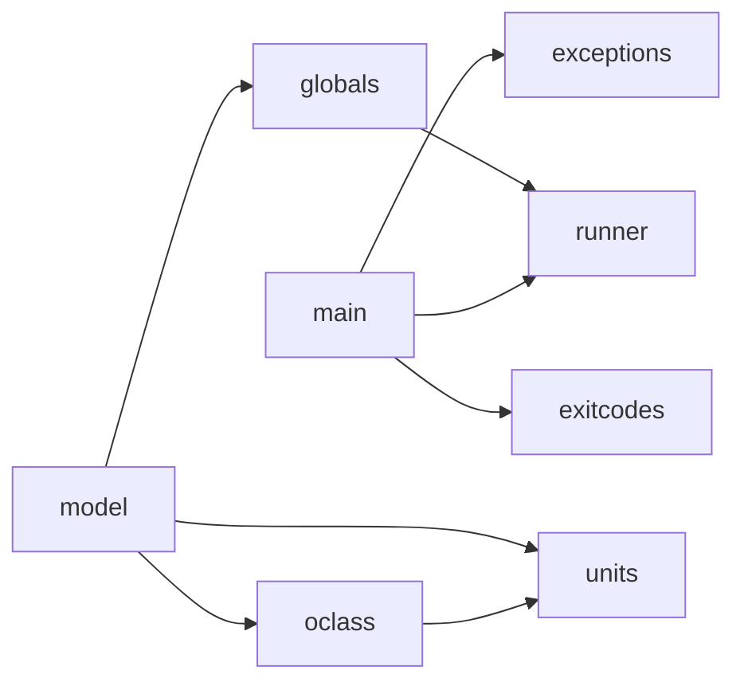

# arras-energy/arras — package design (draft 1)

Status: decisions recorded from the code as merged through #16, 2026-11-23

## Purpose

`arras` is the Python package of the Arras Energy release of HiPAS
GridLAB-D. It provides:

- the `arras` command, which runs the installed `gridlabd` simulator, and
- an independent Python model of the gridlabd core's data structures:
  global variables (`arras.globals`), object classes (`arras.oclass`),
  units (`arras.units`), and models with GLM and JSON input and output
  (`arras.model`).

The Python model reads, checks, edits, and writes what gridlabd reads and
writes, without running `gridlabd`. Users get the same values, text, and
errors that gridlabd gives, or a documented difference.

Excluded: the simulation itself (clock, synchronization passes, solvers)
and the gridlabd modules (`powerflow`, `residential`, ...). These stay in
the C++ code of [arras-energy/gridlabd](https://github.com/arras-energy/gridlabd).
The classes that modules publish come into `arras` from JSON that gridlabd
writes.

Reference version: gridlabd `master` at 076e78a (2026-08-16). Every
"Differences from gridlabd" section in the module docstrings is stated
against that commit.

## Decisions settled

Decisions are numbered `MAJOR.MINOR`. The major number groups decisions by
module (1 is the whole package); the minor number is the decision. Numbers
are permanent: a new decision takes the next minor number in its group, a
new module takes the next major number, and a reversed decision is edited in
place with the date noted rather than deleted. Code comments, issues, and
PRs can cite "decision 4.3".

### 1. Package

| # | Decision |
|---|---|
| 1.1 | `arras` is an independent Python model of the gridlabd core. Apart from `arras.runner`, no module reads from or writes to a running `gridlabd` process or loads module libraries. |
| 1.2 | Where gridlabd's code and its documentation agree, `arras` reproduces the code's behavior: the same output strings, the same accepted inputs, and the same numbers. This includes parsing quirks that change results (see 5.4). |
| 1.3 | Where gridlabd's code and its documentation disagree, `arras` follows the documentation. |
| 1.4 | Every behavior that differs from gridlabd is listed in a numbered "Differences from gridlabd" section of the module docstring, with the gridlabd commit it was checked against, and called out for review in the PR that introduces it. |
| 1.5 | Each part of the gridlabd core is one module with one public class (`Globals`, `Class`, `Units`, `Model`). The public classes and their exceptions are re-exported from `arras/__init__.py`. |
| 1.6 | Each module raises its own exception (`GlobalsError`, `ClassError`, `UnitsError`, `ModelError`), all derived from `arras.exceptions.ArrasException`. Arguments are checked early, and the exceptions are documented. |
| 1.7 | Docstrings are the user documentation (pdoc, published to https://arras-energy.github.io/arras). Each module docstring has Syntax, Arguments, a spec-style Description ("expected to satisfy: 1. ..."), Examples with real output, Caveats, Differences from gridlabd, and References to the gridlabd source files. |
| 1.8 | Module docstring examples and the README examples run as doctests in the test suite. |
| 1.9 | Tests are fast and self-contained: no network, no credentials, no gridlabd install; the suite finishes in seconds. Coverage is reported but has no threshold. |
| 1.10 | Python 3.12 only (`requires-python = "== 3.12.*"`). CI pins `ubuntu-24.04` and Python 3.12 and installs the package non-editable to catch packaging mistakes. |
| 1.11 | Source layout is `src/arras/`; tests are in `src/arras/_test/` with their data in `src/arras/_test/data/` and a README for each. |

### 2. Command line and runner (`main`, `runner`, `exitcodes`, `exceptions`)

| # | Decision |
|---|---|
| 2.1 | The `arras` command (`arras.main:main`) passes its arguments unchanged to `gridlabd.bin` through `arras.runner.Runner` and returns gridlabd's exit code. It does not parse the options itself; the option list in the package docstring is gridlabd's. |
| 2.2 | `Runner` sets the `GLD_*` and `GLPATH` environment variables from `Runner.GRIDLABD_PATH` (`/usr/local/opt/gridlabd/current`) only when the caller's environment does not already set them. The executable defaults to `$GLD_BIN/gridlabd.bin` and can be replaced with the `exe` argument; all other keyword arguments go to `subprocess.run`. |
| 2.3 | Exit codes in `arras.exitcodes` use gridlabd's values. An exception caught by `main()` returns `EXCEPTION` (255). |
| 2.4 | An exception caught by `main()` prints one line, `EXCEPTION [arras/FILE@LINE]: MESSAGE`, to stderr. `arras.exceptions.DEBUG` re-raises instead, and `TRACE` adds a traceback. |

### 3. Global variables (`arras.globals`)

| # | Decision |
|---|---|
| 3.1 | `Globals()` defines every entry of the `map[]` table in gridlabd's `source/globals.cpp` (160 names, including the aliases that share storage), in the same order, with the same type, access, description, and keywords, and with the defaults of `source/globals.h`. |
| 3.2 | `get(name)` returns the string that `gridlabd --globals` prints for that global, using gridlabd's conversion rules. `set(name,value)` converts strings as `global_setvar()` does and also accepts typed Python values. |
| 3.3 | `strictnames` is true by default, as in gridlabd: setting an undefined name raises `GlobalsError`. When it is false, the name is created as a `char1024` global. |
| 3.4 | `get(spec)` evaluates pseudo-globals and `${...}` expansions in the order that `global_getvar()` tests them, and returns `None` where gridlabd returns `NULL`. |
| 3.5 | Pseudo-globals that need a model (`FIND`, `object.last`, `GEOCODE OBJECT`) call the assignable hooks `object_finder`, `object_last`, and `object_locator`, so `arras.globals` does not depend on `arras.model`. Without a hook, `FIND` returns an empty string and the others return `None`. |
| 3.6 | Values that gridlabd fixes at build or run time (`version*`, `command_line`, `origin`, `gitbranch`, ...) come from the installed `arras` version or start empty. Folder globals come from `GLD_*` when set, else from `Runner.GRIDLABD_PATH`. All can be overridden in the constructor. |
| 3.7 | `set()` does not check `access`, matching `global_setvar()`; the access value is recorded only. |
| 3.8 | Random numbers come from Python's `random` module seeded by `randomseed`. Sequences differ from gridlabd's generator even with the same seed. |
| 3.9 | `timezone_locale` supports `UTC` and IANA zone names (Python `zoneinfo`) only; gridlabd's `tzinfo.txt` is not read. |
| 3.10 | `${PYTHON ...}` and `${SHELL ...}` run code, as in gridlabd. They are not sandboxed; the docstring warns against expanding untrusted text. |
| 3.11 | Expansion forms follow `docs/GLM/Global/` where the core disagrees: `//` replaces every match; `/`, `&`, `|`, `^` are integer operators on int32 globals (`&`, `|~` compare only before `?`); `RANGE` accepts `:`; `:=` and `=string` create the global even under `strictnames`; `RANDOM sampled(...)` and `gamma(alpha[,beta])` work; `RANGE` with a step of zero or less raises. `profile_output_format` keeps the core's empty keyword table. (Module docstring, differences 1–7.) |

### 4. Object classes (`arras.oclass`)

| # | Decision |
|---|---|
| 4.1 | The module is named `oclass` because `class` is a Python keyword; the class is `Class`. |
| 4.2 | `Class.registry` is shared by the whole Python process, as gridlabd's class list is shared by a run. `Class.reset()` clears it. A name may be registered once per module (GLM classes count as module `None`); the same name in another module is allowed. |
| 4.3 | `arras.oclass` does not load module libraries. Module classes are registered by the user or from gridlabd JSON by `arras.model` (6.3). |
| 4.4 | There are two ways to add a property, matching gridlabd's two paths: `add_property()` follows the GLM loader's `class` block rules (an existing property of the same type is returned; a new one is an extended property), and `publish()` follows `class_define_map()` for module classes (`name[unit]` form, reserved header names refused). |
| 4.5 | Units are checked with one `arras.units.Units` manager shared by all classes, `Class.units`, loaded on first use. Users assign another `Units` object to use another unit file; `Class.reset()` keeps it. `Property.unit` stays the unit name and `Property.unit_spec` holds the resolved `Unit`. (#14) |
| 4.6 | Objects are not modeled in `arras.oclass`. `numobjs` is incremented by the object model (`arras.model`), and no property can be added to a class once `numobjs > 0`, as in gridlabd. |
| 4.7 | Class functions are Python callables. Event handlers are stored as script text and are not run. Intrinsic functions, C++ code blocks, `notify` hooks, property delegation, and memory sizes and offsets are not modeled. |
| 4.8 | `modhelp()`, `to_glm()`, and `to_xml()` return the text that `print_class_d()`, `class_saveall()`, and `class_saveall_xml()` write, including the empty `class X {}` block that `class_saveall()` writes without `GSO_NOMACROS`. |
| 4.9 | Stricter than the core, checked when the call is made: `set_parent()` refuses an inheritance loop; `define_keyword()` refuses properties that are not `enumeration` or `set`; `publish()` raises for a `name[unit]` on a type other than `double`/`complex` and for an unknown `unit=`. A deprecated property is logged once. (Module docstring, differences 1–5.) |

### 5. Units (`arras.units`)

| # | Decision |
|---|---|
| 5.1 | `Units` is a port of the gridlabd core unit manager (`source/unit.cpp`) and reads the same `unitfile.txt` format. A copy of gridlabd's `runtime/unitfile.txt` ships in the package (`package-data`). |
| 5.2 | `Units()` loads the first `unitfile.txt` found in the working folder, then each `GLPATH` folder, then the bundled copy. |
| 5.3 | Each `Units` object has its own unit list. Prefixed and compound units are derived when `find()` asks for them and added to that list, as `unit_find()` does. |
| 5.4 | The parsing behaviors of `unit.cpp` that change results are reproduced so conversions give the same numbers (leading number read twice, `$` ending a derivation, reverse prefix order, second `^` ignored, offset applied to the imaginary part). Each is documented so it can be fixed in both code bases together. |
| 5.5 | `find()` and `convert()` raise `UnitsError` where gridlabd returns `NULL` or `0`. `convert()` returns the value unchanged when both unit names are the same string, as `unit_convert()` does. |
| 5.6 | `test()` runs the conversion table of gridlabd's `unit_test()` (`gridlabd --unitstest`) and returns the number of failures. |

### 6. Models (`arras.model`)

| # | Decision |
|---|---|
| 6.1 | `Model.objects` is a `dict` keyed on object name. An unnamed object is keyed `CLASS:ID`, the name gridlabd's JSON writer uses. |
| 6.2 | An `Object` is a `dict` of property name to value text, with its class in `Object.oclass`. Only properties that were set are stored; `get_property()` returns the class default for the others, or the type default for GLM-declared properties. |
| 6.3 | Classes are registered in the shared `Class.registry` (4.2). Module classes come from gridlabd JSON (`load_classes()`, `read_json()`), from the `Model.module_loader` hook when a GLM file loads a module, or from the user. Runtime classes come from GLM `class` blocks and the JSON `classes` section. |
| 6.4 | Property names and values are checked when they are set: the name must be a header property, an `on_<event>` handler, or a property of the class or a parent; the value is checked against the property type (units converted with `arras.units`, keywords, integer ranges, `charN` sizes, timestamps, references). `strict=False` logs a warning and stores the value as given. |
| 6.5 | `parent` and `object` references are checked when a read finishes, so files may refer to objects that appear later. No object may be its own ancestor. |
| 6.6 | A method that adds, deletes, or sets more than one item checks all of them before changing the model: either every change is made or none is. |
| 6.7 | A GLM or JSON read that fails keeps what was read before the error; reads are not all-or-nothing. |
| 6.8 | `delete_object()` takes `children="error"`, `"orphan"`, or `"delete"`, and `rename()` updates references. Neither has a gridlabd equivalent. |
| 6.9 | JSON follows gridlabd's `GldJsonWriter` format. `write_json()` writes set values, then the class defaults of the other `PUBLIC` properties (left out when `filesave_options` has the `MINIMAL` bit). It leaves out `types`, `object_size`, and `profiler.*`, which need a running gridlabd. |
| 6.10 | `write_glm()` writes only `PUBLIC` globals that differ from their defaults, without `savefile` and `randomstate` (`NOSAVE_GLOBALS`), and writes timestamps in UTC. Its output reads back into the same objects, ids, and values. |
| 6.11 | GLM support is a listed subset of directives and macros (see the module Caveats). Anything else raises `ModelError` with the file and line rather than being skipped. |
| 6.12 | A value that ends at a newline without `;` is refused. |
| 6.13 | Time zone abbreviations (e.g. `PST`) in JSON globals that `Globals` cannot convert (3.9) leave the global at its default and log a warning. Object timestamps in that form are stored as given. |
| 6.14 | Numbers written after unit conversion are rounded to 15 significant digits, so conversion errors such as `1500.0000000000002` do not appear. |

## Conventions inherited

From the Eudoxys package guidelines
([eudoxys/claude](https://github.com/eudoxys/claude), `skills/eudoxys-package`):

- pdoc documentation from docstrings, with the docstring section style
  (dashed underlines, `` - `name`: text `` bullets);
- module-level `_logger = logging.getLogger(__file__)`, no `print` in
  library code;
- type-annotated arguments; arguments checked early with documented
  exceptions;
- Validation workflow (pylint informational, pytest with coverage) and
  Documentation workflow (pdoc plus coverage report to GitHub Pages after
  Validation passes on `main`); Validation, Coverage, and Documentation
  badges in the README;
- pinned runner and Python in CI;
- one concern per PR, each PR referencing an approved issue.

Departures: the package uses a `src/` layout, and its documentation is
published at https://arras-energy.github.io/arras rather than under
`eudoxys.com`.

## Module layout

```
src/arras/
  __init__.py      package docs (CLI options, Python API); re-exports
  main.py          main(args): `arras` command entry point
  runner.py        Runner(*args, **kwargs): runs gridlabd.bin
  exitcodes.py     gridlabd exit codes
  exceptions.py    ArrasException, exception(): error output
  globals.py       Globals(values, **kwargs): global variables
  oclass.py        Class(name, module, passconfig), Property: object classes
  units.py         Units(file), Unit: unit manager
  unitfile.txt     copy of gridlabd runtime/unitfile.txt
  model.py         Model(file, globals, strict), Object: models, GLM/JSON I/O
  _test/           pytest tests, one test_<module>.py per module
    data/          gridlabd-written test inputs (case14.json)
```

Dependencies between modules:



## Contracts

| class | constructor | holds |
|---|---|---|
| `Globals` | `Globals(values=None, **kwargs)` | global variables, as strings via `get()` |
| `Class` | `Class(name, module=None, passconfig=0)`, `Class.declare(name, parent)` | class registry entry and its properties |
| `Units` | `Units(file=None)` | unit list; `find()` returns `Unit`, `convert()` returns a number |
| `Model` | `Model(file=None, globals=None, strict=True)` | globals, modules, classes, schedules, filters, objects |

A `Model` composes the others: it owns one `Globals`, registers its classes
in the shared `Class.registry`, and checks units with the shared
`Class.units`.

## Sources

Each module is checked against these gridlabd files (`master` 076e78a):

| module | gridlabd source |
|---|---|
| `globals` | `source/globals.cpp`, `globals.h`, `convert.cpp`, `timestamp.cpp`, `random.cpp`, `tmpfile.cpp`; `docs/GLM/Global/` |
| `oclass` | `source/class.cpp`, `class.h`, `property.cpp`, `property.h`, `unit.cpp`, `load.cpp`, `cmdarg.cpp`; `docs/GLM/Directive/Class.md`, `docs/Command/Modhelp.md` |
| `units` | `source/unit.cpp`, `unit.h`, `runtime/unitfile.txt`; `docs/Command/Unitstest.md` |
| `model` | `source/load.cpp`, `json.cpp`, `object.cpp`, `module.cpp`, `save.cpp`; `docs/GLM/Directive/` |
| `exitcodes`, `runner` | gridlabd exit codes and install layout |

## Files and formats

| format | read | write | reference |
|---|---|---|---|
| GLM | `Model.read_glm()` | `Model.write_glm()` | `source/load.cpp`, `source/save.cpp` |
| gridlabd JSON | `Model.read_json()`, `Model.load_classes()` | `Model.write_json()` | `source/json.cpp` (`gridlabd -o FILE.json`, `gridlabd --modhelp=json MODULE`) |
| unit file | `Units()` | — | `runtime/unitfile.txt` |
| modhelp text, class GLM, class XML | — | `Class.modhelp()`, `to_glm()`, `to_xml()` | `source/cmdarg.cpp`, `source/class.cpp` |

## Dependencies

| need | status |
|---|---|
| third-party packages | none; standard library only |
| `gridlabd` install | only for the `arras` command (`Runner`); not for the Python API or tests |

## Known issues to handle

- `pyproject.toml` reads dependencies from `requirements.txt`, which is not
  in the repository.
- `[project.urls]` in `pyproject.toml` point to `arras-energy/gridlabd` and
  `https://arras.energy/gridlabd`, not to this repository and its
  documentation site.
- `Runner` does not capture output unless the caller passes
  `capture_output=True`, so `main()` prints nothing itself and gridlabd's
  output goes straight to the terminal.
- The GLM that `write_glm()` produces has not yet been loaded with
  `gridlabd` (#16).
- Assumption: `Runner.GRIDLABD_PATH` defaults to
  `/usr/local/opt/gridlabd/current`; override it with the `GLD_*`
  environment variables or by assigning the class attribute.

## Open questions

1. Should any of the listed differences from gridlabd (3.11, 4.9, 6.4,
   6.12) match the core instead? Each PR asked; none has been reversed.
2. Should `Globals` use `arras.units` for `double` globals with units? It
   accepts only the declared unit now (#12).
3. Should `publish()` log and continue for unit errors, as the core does,
   instead of raising (#14)?
