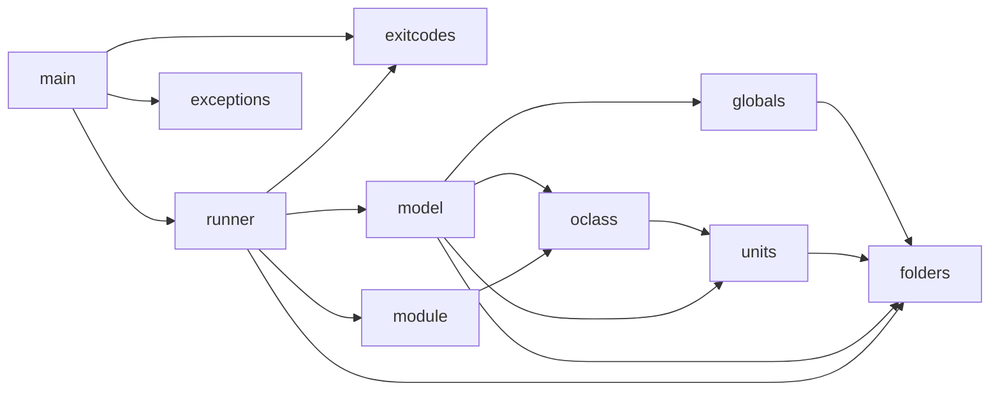

# arras-energy/arras — package design (draft 2)

Status: decisions recorded from the code as merged through #16, 2026-11-23;
modules and solver dispatch (`arras.module`, #22) added 2026-11-23;
internal item and heartbeat dispatch added 2026-11-23;
runner decisions revised for #45, 2026-11-24;
folders without a gridlabd install (`arras.folders`, decision 1.12, #47), 2026-11-24

## Purpose

`arras` is the Python package of the Arras Energy release of HiPAS
GridLAB-D. It provides:

- the `arras` command and `arras.runner.Runner`, which solve the
  quasi-steady time series of a model in Python, and
- an independent Python model of the gridlabd core's data structures:
  global variables (`arras.globals`), object classes (`arras.oclass`),
  units (`arras.units`), models with GLM and JSON input and output
  (`arras.model`), and modules with the solvers that keep the clock
  synchronized (`arras.module`).

The Python model reads, checks, edits, and writes what gridlabd reads and
writes, without running `gridlabd`. Users get the same values, text, and
errors that gridlabd gives, or a documented difference.

`arras.runner` models the main loop of the gridlabd core (clock advance,
object synchronization passes, iteration, commit) and calls the objects'
event handlers and the module solvers, heartbeats, and internal items of
`arras.module` as the core does; it does not run `gridlabd` (since
2026-11-24, #45, answering #25). `arras.module` models how the core combines
the results of the solvers that modules export, the class heartbeat
functions, and the internal items (random variables, schedules, loadshapes,
transforms, enduses), with all of them written as Python callables
(decisions 7.3, 7.8, 7.9). Excluded: the gridlabd modules (`powerflow`,
`residential`, ...) themselves, deltamode, realtime mode, and multithreaded
passes. These stay in the C++ code of
[arras-energy/gridlabd](https://github.com/arras-energy/gridlabd).
The classes that modules publish come into `arras` from JSON that gridlabd
writes.

Reference version: gridlabd `master` at 076e78a (2026-08-16). Every
"Differences from gridlabd" section in the module docstrings is stated
against that commit.

## Decisions settled

Decisions are numbered `MAJOR.MINOR`. The major number groups decisions by
module (1 is the whole package); the minor number is the decision. Numbers
are permanent: a new decision takes the next minor number in its group, a
new module takes the next major number, and a reversed decision is edited in
place with the date noted rather than deleted. Code comments, issues, and
PRs can cite "decision 4.3".

### 1. Package

| # | Decision |
|---|---|
| 1.1 | `arras` is an independent Python model of the gridlabd core. No module reads from or writes to a running `gridlabd` process or loads module libraries. (Edited 2026-11-24, #45: `arras.runner` no longer runs `gridlabd`.) |
| 1.2 | Where gridlabd's code and its documentation agree, `arras` reproduces the code's behavior: the same output strings, the same accepted inputs, and the same numbers. This includes parsing quirks that change results (see 5.4). |
| 1.3 | Where gridlabd's code and its documentation disagree, `arras` follows the documentation. |
| 1.4 | Every behavior that differs from gridlabd is listed in a numbered "Differences from gridlabd" section of the module docstring, with the gridlabd commit it was checked against, and called out for review in the PR that introduces it. |
| 1.5 | Each part of the gridlabd core is one module with one public class (`Globals`, `Class`, `Units`, `Model`, `Module`). The public classes and their exceptions are re-exported from `arras/__init__.py`. (`Module` added 2026-11-23, #22.) |
| 1.6 | Each module raises its own exception (`GlobalsError`, `ClassError`, `UnitsError`, `ModelError`, `ModuleError`), all derived from `arras.exceptions.ArrasException`. Arguments are checked early, and the exceptions are documented. (`ModuleError` added 2026-11-23, #22.) |
| 1.7 | Docstrings are the user documentation (pdoc, published to https://arras-energy.github.io/arras). Each module docstring has Syntax, Arguments, a spec-style Description ("expected to satisfy: 1. ..."), Examples with real output, Caveats, Differences from gridlabd, and References to the gridlabd source files. |
| 1.8 | Module docstring examples and the README examples run as doctests in the test suite. |
| 1.9 | Tests are fast and self-contained: no network, no credentials, no gridlabd install; the suite finishes in seconds. Coverage is reported but has no threshold. |
| 1.10 | Python 3.12 only (`requires-python = "== 3.12.*"`). CI pins `ubuntu-24.04` and Python 3.12 and installs the package non-editable to catch packaging mistakes. |
| 1.11 | Source layout is `src/arras/`; tests are in `src/arras/_test/` with their data in `src/arras/_test/data/` and a README for each. |
| 1.12 | `arras` does not depend on gridlabd folders or files (`/usr/local/opt/gridlabd`, `GLD_*`, `GLTEMP`, `~/.gridlabd`, `/tmp/gridlabd-*`). `arras.folders` gives three folders: the package folder (`PACKAGEDIR`, where Python imports `arras` from) for files installed with `arras`; the user folder (`ARRAS_USERDIR`, else `~/.arras`, with `share`, `lib`, `include`, `var`, and `tmp` subfolders) for files installed at runtime and shared by all models; and the working folder for project files. Files are searched in the working folder, the user `share` folder, the folders listed in `GLPATH` (optional, separated by `;` or `os.pathsep`), then the package folder. No folder is created unless code asks for it. (2026-11-24, #47) |

### 2. Command line and runner (`main`, `runner`, `exitcodes`, `exceptions`)

| # | Decision |
|---|---|
| 2.1 | The `arras` command (`arras.main:main`) passes its arguments to `arras.runner.Runner`, prints the runner's output and error lines through the progress callback as they arrive, and returns the runner's exit code. `Runner` processes the arguments in order: model files, `-D`, `-o`, `-c`, `-C`, `-I`, `-q`, `-v`, `-w`, `--debug`; any other option fails with `ARGERR`. The package docstring lists only these options. (Edited 2026-11-24, #45: the command no longer runs `gridlabd.bin`.) |
| 2.2 | `Runner` does not set environment variables or run an executable; the `exe` and `subprocess.run` keyword arguments are removed (#45). `Runner.GRIDLABD_PATH` is removed: folder globals come from `arras.folders` (1.12, 3.6). (Edited 2026-11-24.) |
| 2.3 | Exit codes in `arras.exitcodes` use gridlabd's values. An exception caught by `main()` returns `EXCEPTION` (255). |
| 2.4 | An exception caught by `main()` prints one line, `EXCEPTION [arras/FILE@LINE]: MESSAGE`, to stderr. `arras.exceptions.DEBUG` re-raises instead, and `TRACE` adds a traceback. |
| 2.5 | `Runner` reproduces the event-mode main loop of `GldExec::exec_start()` (`source/exec.cpp`): objects initialized in creation order with `init_max_defer` deferral rounds, then `Module.initall()`; at each iteration `Module.internalsyncall()` with the objects whose `heartbeat` header is greater than 0; on the first iteration of a time step object precommit then `Module.precommitall()`, whose result is posted as an event (the clock itself means no event); `Module.presyncall()` and presync top-down, sync bottom-up and `Module.syncall()`, `Module.postsyncall()` and postsync top-down, by rank (parents rank above children, `set_rank()`), equal ranks in creation order, with `Module.transformsyncall()` for non-schedule sources after each pass; hard and soft events merged as `sync_set()` does, with `stoptime+1` as a hard event when `stoptime` is set; `minimum_timestep` rounding of object hard events; iteration while the earliest event is the clock, up to `iteration_limit`; object commit then `Module.commitall()`, every object's `clock` set, then `Module.clockupdateall()`, posted as a hard event only when it lowers the next time; `in_svc`/`out_svc`; finalize then `Module.termall()` after the time series, also after a failure or stop. Object commit times other than `TS_INVALID` and 0 are ignored, as in `commit_all()`. Two core behaviors are fixed rather than reproduced (2.12, 2.13). (Edited 2026-11-24, #45: module solvers, internal items, and heartbeats added after #23 merged.) |
| 2.6 | Object behavior comes only from event handlers (`docs/GLM/Object/Events.md`): an object's `on_<event>` property, else its class's. `python:MODULE.FUNCTION` calls `FUNCTION(name, t)`; other text runs as a shell command with `CLOCK`, `HOSTNAME`, `PORT`, and `OBJECT` set and its output lines captured. Class `PASSCONFIG` bits do not add objects to passes. For each module that the model loads and that has no solvers in `Module.registry`, a Python file `NAME.py` in a `pythonpath` folder, the working folder, or the user `lib` folder (1.12) is imported and its `on_init(t)` ... `on_term(t)` functions become the module's solvers, wrapped as `python/python.cpp` does (exceptions and non-integer sync results give `TS_INVALID` or false with an error line). The module stays registered after the run. |
| 2.7 | Errors during a run do not raise: `Runner` records `returncode` (`ARGERR`, `LDERR`, `INIERR`, `RUNERR`, `IOERR`, or `EXCEPTION` for an unexpected exception) and adds `ERROR [TIME]: text` to `stderr`. Only bad constructor arguments raise `RunnerError`. |
| 2.8 | `stdout` and `stderr` are lists of lines. Handlers add lines with `Runner.current().output()` and `.error()`; verbose, warning, and debug lines follow the `verbose`, `warn`, `debug`, and `quiet` globals of the model. |
| 2.9 | `background=True` runs the simulation in a daemon thread of the calling process; `running`, `wait()`, and `stop()` control it. A thread rather than a process keeps the model, its classes, and Python handlers shared with the caller without serialization. |
| 2.10 | The progress callback is called after each committed time step and once at the end, with only those of the optional arguments `timestamp`, `percent`, `stdout`, `stderr` that its signature names (all with `**kwargs`); `stdout` and `stderr` hold the lines added since the previous call. Returning `False` stops the run; raising stops it with `RUNERR`. |
| 2.11 | The model given with `-o` is written whenever the model was loaded, also after a failed run. |
| 2.12 | Soft events alone end a run when `stoptime` is `NEVER`, as the comment in `exec_start()` intends. gridlabd's `clock_update_modules()` posts the next time as a hard event after every committed step, so its loop never stops on soft events; `Runner` posts the `clockupdate` result only when a solver lowers the next time. Listed as runner difference 8. (2026-11-24, #45.) |
| 2.13 | A module `precommit` result is checked and used like a `presync` result: `TS_INVALID`, 0, or a time before the clock fails the run, and a later time is an event. gridlabd's `precommit_all()` tests `module_precommitall()` as a truth value, so only 0 fails and times are discarded. A Python module's `on_precommit` may return `True` (no event) or `False` (failure). Listed as runner difference 9. (2026-11-24, #45.) |

### 3. Global variables (`arras.globals`)

| # | Decision |
|---|---|
| 3.1 | `Globals()` defines every entry of the `map[]` table in gridlabd's `source/globals.cpp` (160 names, including the aliases that share storage), in the same order, with the same type, access, description, and keywords, and with the defaults of `source/globals.h`. |
| 3.2 | `get(name)` returns the string that `gridlabd --globals` prints for that global, using gridlabd's conversion rules. `set(name,value)` converts strings as `global_setvar()` does and also accepts typed Python values. |
| 3.3 | `strictnames` is true by default, as in gridlabd: setting an undefined name raises `GlobalsError`. When it is false, the name is created as a `char1024` global. |
| 3.4 | `get(spec)` evaluates pseudo-globals and `${...}` expansions in the order that `global_getvar()` tests them, and returns `None` where gridlabd returns `NULL`. |
| 3.5 | Pseudo-globals that need a model (`FIND`, `object.last`, `GEOCODE OBJECT`) call the assignable hooks `object_finder`, `object_last`, and `object_locator`, so `arras.globals` does not depend on `arras.model`. Without a hook, `FIND` returns an empty string and the others return `None`. |
| 3.6 | Values that gridlabd fixes at build or run time (`version*`, `command_line`, `origin`, `gitbranch`, ...) come from the installed `arras` version or start empty. Folder globals come from `arras.folders` (1.12): `datadir`, `libdir`, `incdir`, `vardir`, and `tmp` are subfolders of the user folder, `configpath`, `logfile`, and `pidfile_dir` are in it, `bindir` is the Python scripts folder, and `pythonexec` is the running Python. `GLD_*` and `GLTEMP` are not read; `${FINDFILE}` searches the folders of 1.12, including `GLPATH`. All can be overridden in the constructor. (Edited 2026-11-24.) |
| 3.7 | `set()` does not check `access`, matching `global_setvar()`; the access value is recorded only. |
| 3.8 | Random numbers come from Python's `random` module seeded by `randomseed`. Sequences differ from gridlabd's generator even with the same seed. |
| 3.9 | `timezone_locale` supports `UTC` and IANA zone names (Python `zoneinfo`) only; gridlabd's `tzinfo.txt` is not read. |
| 3.10 | `${PYTHON ...}` and `${SHELL ...}` run code, as in gridlabd. They are not sandboxed; the docstring warns against expanding untrusted text. |
| 3.11 | Expansion forms follow `docs/GLM/Global/` where the core disagrees: `//` replaces every match; `/`, `&`, `|`, `^` are integer operators on int32 globals (`&`, `|~` compare only before `?`); `RANGE` accepts `:`; `:=` and `=string` create the global even under `strictnames`; `RANDOM sampled(...)` and `gamma(alpha[,beta])` work; `RANGE` with a step of zero or less raises. `profile_output_format` keeps the core's empty keyword table. (Module docstring, differences 1–7.) |

### 4. Object classes (`arras.oclass`)

| # | Decision |
|---|---|
| 4.1 | The module is named `oclass` because `class` is a Python keyword; the class is `Class`. |
| 4.2 | `Class.registry` is shared by the whole Python process, as gridlabd's class list is shared by a run. `Class.reset()` clears it. A name may be registered once per module (GLM classes count as module `None`); the same name in another module is allowed. |
| 4.3 | `arras.oclass` does not load module libraries. Module classes are registered by the user or from gridlabd JSON by `arras.model` (6.3). |
| 4.4 | There are two ways to add a property, matching gridlabd's two paths: `add_property()` follows the GLM loader's `class` block rules (an existing property of the same type is returned; a new one is an extended property), and `publish()` follows `class_define_map()` for module classes (`name[unit]` form, reserved header names refused). |
| 4.5 | Units are checked with one `arras.units.Units` manager shared by all classes, `Class.units`, loaded on first use. Users assign another `Units` object to use another unit file; `Class.reset()` keeps it. `Property.unit` stays the unit name and `Property.unit_spec` holds the resolved `Unit`. (#14) |
| 4.6 | Objects are not modeled in `arras.oclass`. `numobjs` is incremented by the object model (`arras.model`), and no property can be added to a class once `numobjs > 0`, as in gridlabd. |
| 4.7 | Class functions are Python callables. Event handlers are stored as script text and are not run. Intrinsic functions, C++ code blocks, `notify` hooks, property delegation, and memory sizes and offsets are not modeled. |
| 4.8 | `modhelp()`, `to_glm()`, and `to_xml()` return the text that `print_class_d()`, `class_saveall()`, and `class_saveall_xml()` write, including the empty `class X {}` block that `class_saveall()` writes without `GSO_NOMACROS`. |
| 4.9 | Stricter than the core, checked when the call is made: `set_parent()` refuses an inheritance loop; `define_keyword()` refuses properties that are not `enumeration` or `set`; `publish()` raises for a `name[unit]` on a type other than `double`/`complex` and for an unknown `unit=`. A deprecated property is logged once. (Module docstring, differences 1–5.) |

### 5. Units (`arras.units`)

| # | Decision |
|---|---|
| 5.1 | `Units` is a port of the gridlabd core unit manager (`source/unit.cpp`) and reads the same `unitfile.txt` format. A copy of gridlabd's `runtime/unitfile.txt` ships in the package (`package-data`). |
| 5.2 | `Units()` loads the first `unitfile.txt` found in the working folder, then the user `share` folder, then each `GLPATH` folder, then the bundled copy in the package folder (1.12). (Edited 2026-11-24.) |
| 5.3 | Each `Units` object has its own unit list. Prefixed and compound units are derived when `find()` asks for them and added to that list, as `unit_find()` does. |
| 5.4 | The parsing behaviors of `unit.cpp` that change results are reproduced so conversions give the same numbers (leading number read twice, `$` ending a derivation, reverse prefix order, second `^` ignored, offset applied to the imaginary part). Each is documented so it can be fixed in both code bases together. |
| 5.5 | `find()` and `convert()` raise `UnitsError` where gridlabd returns `NULL` or `0`. `convert()` returns the value unchanged when both unit names are the same string, as `unit_convert()` does. |
| 5.6 | `test()` runs the conversion table of gridlabd's `unit_test()` (`gridlabd --unitstest`) and returns the number of failures. |

### 6. Models (`arras.model`)

| # | Decision |
|---|---|
| 6.1 | `Model.objects` is a `dict` keyed on object name. An unnamed object is keyed `CLASS:ID`, the name gridlabd's JSON writer uses. |
| 6.2 | An `Object` is a `dict` of property name to value text, with its class in `Object.oclass`. Only properties that were set are stored; `get_property()` returns the class default for the others, or the type default for GLM-declared properties. |
| 6.3 | Classes are registered in the shared `Class.registry` (4.2). Module classes come from gridlabd JSON (`load_classes()`, `read_json()`), from the `Model.module_loader` hook when a GLM file loads a module, or from the user. Runtime classes come from GLM `class` blocks and the JSON `classes` section. |
| 6.4 | Property names and values are checked when they are set: the name must be a header property, an `on_<event>` handler, or a property of the class or a parent; the value is checked against the property type (units converted with `arras.units`, keywords, integer ranges, `charN` sizes, timestamps, references). `strict=False` logs a warning and stores the value as given. |
| 6.5 | `parent` and `object` references are checked when a read finishes, so files may refer to objects that appear later. No object may be its own ancestor. |
| 6.6 | A method that adds, deletes, or sets more than one item checks all of them before changing the model: either every change is made or none is. |
| 6.7 | A GLM or JSON read that fails keeps what was read before the error; reads are not all-or-nothing. |
| 6.8 | `delete_object()` takes `children="error"`, `"orphan"`, or `"delete"`, and `rename()` updates references. Neither has a gridlabd equivalent. |
| 6.9 | JSON follows gridlabd's `GldJsonWriter` format. `write_json()` writes set values, then the class defaults of the other `PUBLIC` properties (left out when `filesave_options` has the `MINIMAL` bit). It leaves out `types`, `object_size`, and `profiler.*`, which need a running gridlabd. |
| 6.10 | `write_glm()` writes only `PUBLIC` globals that differ from their defaults, without `savefile` and `randomstate` (`NOSAVE_GLOBALS`), and writes timestamps in UTC. Its output reads back into the same objects, ids, and values. |
| 6.11 | GLM support is a listed subset of directives and macros (see the module Caveats). Anything else raises `ModelError` with the file and line rather than being skipped. |
| 6.12 | A value that ends at a newline without `;` is refused. |
| 6.13 | Time zone abbreviations (e.g. `PST`) in JSON globals that `Globals` cannot convert (3.9) leave the global at its default and log a warning. Object timestamps in that form are stored as given. |
| 6.14 | Numbers written after unit conversion are rounded to 15 significant digits, so conversion errors such as `1500.0000000000002` do not appear. |

### 7. Modules (`arras.module`)

| # | Decision |
|---|---|
| 7.1 | `Module.registry` is shared by the whole Python process, in load order, as gridlabd's module list is shared by a run; load order is the order in which solvers are called. `Module(name)` refuses a loaded name; `Module.load(name)` returns the loaded module, as `module_load()` does. `Module.reset()` does not touch `Class.registry`. |
| 7.2 | A module's classes are not stored in the module: `Module.classes` lists the classes in `Class.registry` whose `module` is the module's name, so classes registered by `arras.model` or by the user appear without being added twice. `register_class()` creates a `Class` for the module. |
| 7.3 | Solvers are Python callables attached to the hooks of gridlabd's `struct s_module_list` (`SOLVERS`): `init`, `precommit`, `presync`, `sync`, `postsync`, `commit`, `term`, `clockupdate`, and the deltamode hooks `deltamode_desired`, `preupdate`, `interupdate`, `deltaclockupdate`, `postupdate`. A hook is named by its `arras` name or by the symbol a module library exports (`on_sync`, `clock_update`, `deltaClockUpdate`). `on_term` and `term` share one hook. Solvers do not receive the `MODULE*` argument. |
| 7.4 | The dispatchers (`initall()`, `precommitall()`, `presyncall()`, `syncall()`, `postsyncall()`, `commitall()`, `termall()`, `clockupdateall()`, `deltadesiredall()`, `preupdateall()`, `interupdateall()`, `deltaclockupdateall()`, `postupdateall()`) reproduce how `source/module.cpp`, `GldExec::clock_update_modules()`, and `source/deltamode.cpp` combine module results, including the earliest-by-absolute-time rule for soft (negative) times and `TS_INVALID`, which functions stop at the first failure, and which call every module. |
| 7.5 | The dispatchers do not advance a clock or run object passes. Values that the core reads from globals inside these functions (`deltamode_allowed`, `deltamode_timestep`, `global_clock`, `global_deltaclock`, `global_delta_curr_clock`) are arguments; the defaults are gridlabd's (`allowed=False`, 10 ms). `arras.runner.Runner` calls the event-mode dispatchers from its main loop (2.5); deltamode is not run. (Edited 2026-11-24, #45.) |
| 7.6 | Timestamps are `int` seconds and deltamode steps `int` nanoseconds, with gridlabd's constants (`TS_NEVER`, `TS_INVALID`, `TS_MAX`, `DT_INFINITY`, `DT_INVALID`, `DT_SECOND`, `SM_*`). |
| 7.7 | Stricter than the core: a deltamode module (one with a `deltamode_desired` solver) without a `preupdate`, `interupdate`, or `postupdate` solver makes the dispatcher that needs it raise `ModuleError` (the core calls a null pointer); module names with whitespace, `.`, or `:` and versions outside 0 to 65535 are refused; a solver, heartbeat solver, or internal item that returns a non-`int` (or a `bool`) where a time is expected raises `ModuleError`; a transform needs an explicit source (`"UNKNOWN"` for the core's untyped transform). (Module docstring, differences 1–4.) |
| 7.8 | Heartbeat solvers are attached per class by the class's module (`set_heartbeat()`), as a module sets `CLASS::heartbeat`. `heartbeatsyncall(objects)` takes the heartbeat objects from the caller (objects with `heartbeat > 0`, as `exec_init()` collects them) and does not read objects itself; an object whose class has no solver counts as `TS_NEVER`; parents' solvers are not used. |
| 7.9 | Random variables, schedules, loadshapes, transforms, and enduses are internal items: Python callables `sync(t1)` added with `Module.add_internal()` and kept in `Module.internals` in creation order (transforms with their `TRANSFORMSOURCE` bits, schedules with an `interpolated` flag). Their values, shapes, and transform arithmetic (including schedule skew) are the callables' job. |
| 7.10 | `randomvarsyncall()`, `schedulesyncall()`, `loadshapesyncall()`, `transformsyncall()`, `endusesyncall()`, `heartbeatsyncall()`, and `internalsyncall()` reproduce the single-thread paths of the core functions: absolute-time minimum returned as a soft time for random variables and heartbeats, signed minimum for the others, the schedule and loadshape next-time caches (shared by the process, cleared by `Module.reset()`), the interpolated-schedule override, and `syncall_internals()`'s soft-event combination, `minimum_timestep` rounding, and the zero-terminated `earliest_timestamp()` list. Link and instance times, which `arras` does not model, are arguments. |

## Conventions inherited

From the Eudoxys package guidelines
([eudoxys/claude](https://github.com/eudoxys/claude), `skills/eudoxys-package`):

- pdoc documentation from docstrings, with the docstring section style
  (dashed underlines, `` - `name`: text `` bullets);
- module-level `_logger = logging.getLogger(__file__)`, no `print` in
  library code;
- type-annotated arguments; arguments checked early with documented
  exceptions;
- Validation workflow (pylint informational, pytest with coverage) and
  Documentation workflow (pdoc plus coverage report to GitHub Pages after
  Validation passes on `main`); Validation, Coverage, and Documentation
  badges in the README;
- pinned runner and Python in CI;
- one concern per PR, each PR referencing an approved issue.

Departures: the package uses a `src/` layout, and its documentation is
published at https://arras-energy.github.io/arras rather than under
`eudoxys.com`.

## Module layout

```
src/arras/
  __init__.py      package docs (CLI options, Python API); re-exports
  main.py          main(args): `arras` command entry point
  folders.py       PACKAGEDIR, userdir(), workdir(), search_path(), findfile(): folders
  runner.py        Runner(*args, model, background, progress): runs a simulation
  exitcodes.py     gridlabd exit codes
  exceptions.py    ArrasException, exception(): error output
  globals.py       Globals(values, **kwargs): global variables
  oclass.py        Class(name, module, passconfig), Property: object classes
  units.py         Units(file), Unit: unit manager
  unitfile.txt     copy of gridlabd runtime/unitfile.txt
  model.py         Model(file, globals, strict), Object: models, GLM/JSON I/O
  module.py        Module(name, major, minor, **solvers): modules, solver dispatch
  _test/           pytest tests, one test_<module>.py per module
    data/          gridlabd-written test inputs (case14.json)
```

Dependencies between modules (`runner` imports `model` when a `Runner`
is created; since 1.12 `globals` no longer imports `runner`):



## Contracts

| class | constructor | holds |
|---|---|---|
| `Globals` | `Globals(values=None, **kwargs)` | global variables, as strings via `get()` |
| `Class` | `Class(name, module=None, passconfig=0)`, `Class.declare(name, parent)` | class registry entry and its properties |
| `Units` | `Units(file=None)` | unit list; `find()` returns `Unit`, `convert()` returns a number |
| `Model` | `Model(file=None, globals=None, strict=True)` | globals, modules, classes, schedules, filters, objects |
| `Module` | `Module(name, major=0, minor=0, **solvers)`, `Module.load(name)` | module registry entry, its solvers; its classes through `Class.registry` |
| `Runner` | `Runner(*args, model=None, background=False, progress=None)` | the model run, exit code, output and error lines, clock, step count |

A `Model` composes the others: it owns one `Globals`, registers its classes
in the shared `Class.registry`, and checks units with the shared
`Class.units`.

## Sources

Each module is checked against these gridlabd files (`master` 076e78a):

| module | gridlabd source |
|---|---|
| `globals` | `source/globals.cpp`, `globals.h`, `convert.cpp`, `timestamp.cpp`, `random.cpp`, `tmpfile.cpp`; `docs/GLM/Global/` |
| `oclass` | `source/class.cpp`, `class.h`, `property.cpp`, `property.h`, `unit.cpp`, `load.cpp`, `cmdarg.cpp`; `docs/GLM/Directive/Class.md`, `docs/Command/Modhelp.md` |
| `units` | `source/unit.cpp`, `unit.h`, `runtime/unitfile.txt`; `docs/Command/Unitstest.md` |
| `model` | `source/load.cpp`, `json.cpp`, `object.cpp`, `module.cpp`, `save.cpp`; `docs/GLM/Directive/` |
| `module` | `source/module.h`, `module.cpp`, `exec.cpp` (`clock_update_modules()`, `syncall_internals()`, `sync_heartbeats()`, module calls in the sync passes), `deltamode.cpp`, `object.cpp` (`object_heartbeat()`), `random.cpp`, `schedule.cpp`, `loadshape.cpp`, `transform.cpp`, `transform.h`, `enduse.cpp`, `timestamp.h`, `timestamp.cpp`; `docs/GLM/Directive/Module.md` |
| `exitcodes` | gridlabd exit codes |
| `runner` | `source/exec.cpp`, `object.cpp`, `main.cpp`, `module.cpp`; `python/python.cpp` (`python_module_load()`, `python_event()`); `docs/GLM/Object/Events.md`, `docs/Module/Python.md` |

## Files and formats

| format | read | write | reference |
|---|---|---|---|
| GLM | `Model.read_glm()` | `Model.write_glm()` | `source/load.cpp`, `source/save.cpp` |
| gridlabd JSON | `Model.read_json()`, `Model.load_classes()` | `Model.write_json()` | `source/json.cpp` (`gridlabd -o FILE.json`, `gridlabd --modhelp=json MODULE`) |
| unit file | `Units()` | — | `runtime/unitfile.txt` |
| modhelp text, class GLM, class XML | — | `Class.modhelp()`, `to_glm()`, `to_xml()` | `source/cmdarg.cpp`, `source/class.cpp` |

## Dependencies

| need | status |
|---|---|
| third-party packages | none; standard library only |
| `gridlabd` install | not needed (since #45); only gridlabd-written JSON for module classes |

## Known issues to handle

- `pyproject.toml` reads dependencies from `requirements.txt`, which is not
  in the repository (#19).
- `[project.urls]` in `pyproject.toml` point to `arras-energy/gridlabd` and
  `https://arras.energy/gridlabd`, not to this repository and its
  documentation site (#20).
- The GLM that `write_glm()` produces has not yet been loaded with
  `gridlabd` (#16).
- `arras.model.Model.modules` still holds each module as a `dict` of
  `major` and `minor`; `Model.load_module()` does not yet create or use an
  `arras.module.Module` (see open question 4).
- Models and scripts that set `GLD_*` or `GLTEMP` for gridlabd
  get no effect from them in `arras` (1.12): move shared files to the user
  `share` folder (or set `ARRAS_USERDIR`), or set the folder globals in the
  model.

## Open questions

1. Should any of the listed differences from gridlabd (3.11, 4.9, 6.4,
   6.12, 7.7, 2.12, 2.13) match the core instead, or be fixed in the core
   too? Each PR asked; none has been reversed.
2. Should `Globals` use `arras.units` for `double` globals with units? It
   accepts only the declared unit now (#12).
3. Should `publish()` log and continue for unit errors, as the core does,
   instead of raising (#14)?
4. Should `Model` hold `Module` objects (so a model's modules carry their
   solvers), with `Model.load_module()` calling `Module.load()`? Options:
   replace the `modules` dicts with `Module` objects, or keep the dicts and
   look modules up in `Module.registry` by name.
5. Should `background=True` also offer a separate process, for
   simulations whose handlers hold the GIL for long periods (2.9)?
