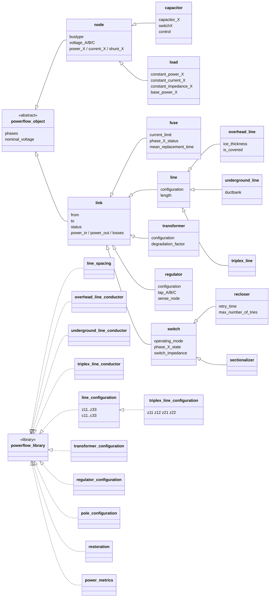

# powerflow

Python implementation of the gridlabd `powerflow` module for Arras Energy. Users load it with `module powerflow;` in a GLM model, and solve the unbalanced three-phase power flow of a distribution network at each time step with PYPOWER's Newton-Raphson, fast-decoupled, or DC solvers (`powerflow.solver`). See the package documentation (`powerflow/__init__.py`) for the globals, the solver, and the differences from gridlabd, and `DESIGN.md` decision group 12 for the design decisions.

## Class hierarchy

Solid arrows are published inheritance (gridlabd `PT_INHERIT`): the class has its parent's properties and is `isa()` its parent. Dotted arrows are C++ relations only: the class derives from the other in gridlabd's C++ code, or answers `isa()` for it, without inheriting its properties.

## Classes

Classes are listed in gridlabd's registration order. TRL is the technology readiness level gridlabd gives the class (9 proven, 8 qualified, 7 prototype, 0 not given).

| Class | Parent | Python class | TRL | Function |
| ----- | ------ | ------------ | --- | -------- |
| `powerflow_object` | — | `powerflow_object.PowerflowObject` | 9 | Abstract base of network objects: phases and nominal voltage, with the phase checks every node and link runs at initialization. |
| `powerflow_library` | — | `powerflow_library.PowerflowLibrary` | 9 | Empty base of the library (data) objects, registered to keep gridlabd's class order. `LibraryObject` adds the initialization checks of the library classes. |
| `node` | `powerflow_object` | `node.Node` | 9 | A bus: one solver bus per phase. Holds the wye and delta constant-power, constant-current, and constant-impedance loads; its voltages are written from each solution. Swing, PV, and PQ bus types; child nodes fold into their parent. |
| `link` | `powerflow_object` | `link.Link` | 9 | A branch between two nodes, with its 3x3 admittance blocks; its currents, powers, losses, and flow direction are written from each solution. Base of the line, switch, and transformer classes (admittance and solution hooks). A plain `link` is a small resistance on each phase. |
| `capacitor` | `node` | `capacitor.Capacitor` | 9 | A switched shunt capacitor bank (wye or delta) with manual, voltage, VAr, VAr-voltage, or current control, dwell and delay times, and bank control. |
| `fuse` | `link` | `fuse.Fuse` | 8 | A link whose phases blow when their current exceeds `current_limit` and are replaced after `mean_replacement_time` (a soft event). A node fed only by the fuse loses the blown phases. |
| `line` | `link` | `line.Line` | 9 | A line of a given length, the pi model of its configuration's impedance and capacitance matrices (capacitance only with `powerflow::line_capacitance`). Base of the overhead, underground, and triplex lines. |
| `line_spacing` | — | `line_spacing.LineSpacing` | 9 | Distances between the phase and neutral wires and to earth, for overhead and underground line impedances. |
| `overhead_line` | `line` | `overhead_line.OverheadLine` | 9 | A line of overhead conductors: impedance by Carson's equations from its configuration's conductors and spacing, the neutral Kron-reduced, and capacitance from the potential coefficients of the conductors and their images (Kersting chapters 4 and 5); or the matrix form when the configuration gives one. |
| `underground_line` | `line` | `underground_line.UndergroundLine` | 9 | A line of underground cables with concentric neutrals or tape shields (or neither) and an optional separate neutral, Kron-reduced, with the cables' capacitance; or the matrix form. Duct banks are not modeled. |
| `overhead_line_conductor` | — | `overhead_line_conductor.OverheadLineConductor` | 9 | Resistance, geometric mean radius, diameter, ratings, weight, and strength of an overhead conductor. |
| `underground_line_conductor` | — | `underground_line_conductor.UndergroundLineConductor` | 9 | Dimensions, resistances, and ratings of a concentric-neutral or tape-shielded underground cable. |
| `line_configuration` | — | `line_configuration.LineConfiguration` | 9 | Impedance (ohm/mile) and capacitance (nF/mile) matrices of a line, or the conductors and spacing they are computed from. |
| `transformer_configuration` | — | `transformer_configuration.TransformerConfiguration` | 9 | Connection, voltages, kVA ratings, series and shunt impedances (per unit), losses, and thermal and in-rush data of a transformer. |
| `transformer` | `link` | `transformer.Transformer` | 9 | A transformer with gridlabd's NR admittance for its configuration's connection: wye-wye, single-phase, delta-delta (phase by phase), or delta-wye (30-degree shift); center-tapped transformers are not solved yet. |
| `load` | `node` | `load.Load` | 9 | A node with constant power, current, and impedance loads (phase, explicit wye, explicit delta) or their ZIP form at given power factors. |
| `regulator_configuration` | — | `regulator_configuration.RegulatorConfiguration` | 9 | Connection, band, delays, taps, transducer ratios, line drop compensation, and control mode of a voltage regulator. |
| `regulator` | `link` | `regulator.Regulator` | 9 | A step voltage regulator: tap-ratio autotransformer with a small resistance; manual taps or automatic control of the output, remote-node, or line-drop-compensated voltage with gridlabd's dwell and delay timing. |
| `triplex_line` | `line` | `triplex_line.TriplexLine` | 9 | A split-phase secondary line (lines 1 and 2 and a neutral): initializes and computes gridlabd's `b_mat` and `tn`, but is not solved until the triplex nodes and center-tapped transformer are ported. |
| `triplex_line_configuration` | — | `triplex_line_configuration.TriplexLineConfiguration` | 9 | Conductors, insulation, and diameter of a split-phase secondary cable, or its 2x2 impedance matrix. A `line_configuration` for `isa()`. |
| `triplex_line_conductor` | — | `triplex_line_conductor.TriplexLineConductor` | 9 | Resistance, geometric mean radius, and ratings of a triplex conductor. |
| `switch` | `link` | `switch.Switch` | 8 | A switch on each phase: closed phases are the switch impedance, open ones connect nothing (isolating a to node fed only by them); banked majority rule or individual phases. |
| `restoration` | — | `restoration.Restoration` | 7 | Settings for reconfiguring the network after a fault: feeder and microgrid limits, vertices, links, and voltage limits. Initialization only; the algorithm runs when `fault_check` is ported. |
| `power_metrics` | — | `power_metrics.PowerMetrics` | 8 | IEEE 1366 reliability indices (SAIFI, SAIDI, CAIDI, ASAI, MAIFI), computed when the reliability module calls it. |
| `recloser` | `switch` | `recloser.Recloser` | 0 | A switch with reclosing settings (tries, retry time); the reclosing itself needs `fault_check`. |
| `sectionalizer` | `switch` | `sectionalizer.Sectionalizer` | 0 | A switch that opens after an upstream recloser operates; needs `fault_check` to open. |
| `pole_configuration` | — | `pole_configuration.PoleConfiguration` | 9 | Material, dimensions, design loads, overload and strength factors, and degradation of a utility pole. Creates `powerflow::climate_impact_zone`. |

## Other modules of the package

| Module | Function |
| ------ | -------- |
| `solver.py` | The three-phase network (`Network`) and its solution with PYPOWER's `newtonpf()`, `fdpf()`, and `dcpf()` (`solve()`). |
| `_module.py` | The module's `init` and `sync` solvers: builds the network from the model's nodes and links, solves it, and writes the results. |
| `_common.py` | Constants, messages, object and module state, and property access shared by the classes. |
| `_base.py` | Class registration from each behavior class's attributes. |
| `_test/` | The tests (see `_test/README.md`). |

## Not yet ported

The other gridlabd powerflow classes derive from the classes above and are to be added as behavior classes that subclass `Node`, `Link`, or `Line`: `meter`, the triplex node classes, `fault_check`, and the others listed in gridlabd's `module/powerflow/init.cpp`. The proposed order is in `DESIGN.md`, open question 12.
